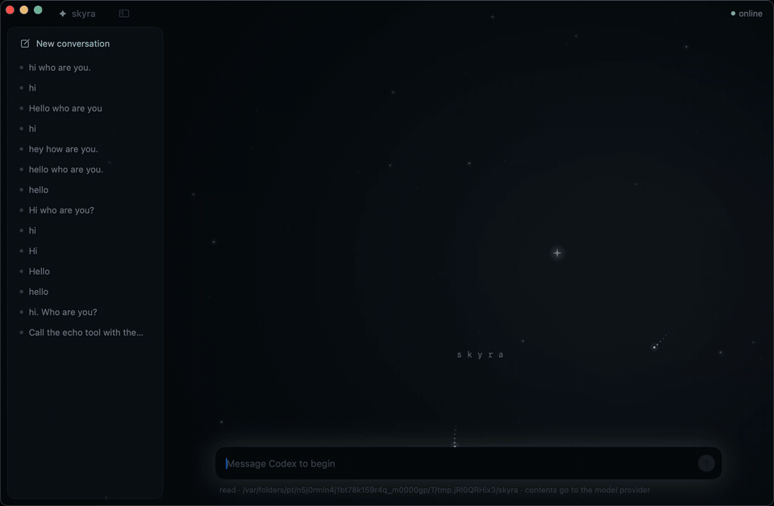

# Skyra

**A runtime for bounded, auditable agents that can build reusable capabilities.
The human approves the boundary once, not every tool; the OS enforces it.**



*The desktop app: real Codex reading this repo. Every tool call runs under the
granted boundary and is recorded.*

Coding agents ask permission for everything, so people stop reading the
prompts and switch on full-auto. Skyra takes a different route: you grant an
agent a boundary once, and the operating system enforces that boundary on
every call, including calls to tools the agent writes for itself. Nothing an
agent says can widen its own authority, and every step is recorded so the
whole run can be replayed and checked.

**What's here:** a stateless execution runtime with a pure Go state machine,
per-call macOS sandboxes, hash-chained records checked by replay, and browser,
terminal and native macOS clients on one protocol. Models propose actions;
the runtime derives and checks what may execute. An interpreter turns
remembered execution strands into reusable procedures within the same authority
boundary. The chat apps are clients of that runtime, not the runtime itself.

The controller uses standard-library Go; the interpreter has CEL dependencies.
The implementation and its remaining gaps are listed [below](#where-we-are).
For the predecessor and rewrite, see [how it got here](#how-it-got-here).

```sh
./install.sh && skyra demo   # every scenario, each ending in a replay check
```


## The problem

Today's coding agents ask before they act: *allow this command? this tool?
this file?* Every prompt is cheap on its own, and together they are the
failure. People stop reading them, click yes, and then switch on full-auto
mode, which trades the prompts for ambient authority: a shell, the whole
workspace and the network, inside a sandbox the agent **reports** about
itself. That is **tool acceptance fatigue**, and self-extension makes it
worse: an agent that writes its own tools produces a stream of new code, and
each piece wants its own approval.

Skyra moves the approval. The human grants a **Horizon** once: an explicit
set of what an agent may invoke. Everything after that, including tools and
procedures the agent builds for itself, runs **without approval**, because
nothing can be created with more authority than its creator holds, and the OS
enforces the boundary on every invocation. Asking the human is reserved for
the one case that needs them: reaching past the Horizon.

Skyra's principal is the **bounded, auditable agent**, not the process. The
full argument, from the pains that drove it: [`docs/grips-and-invariants.md`](docs/grips-and-invariants.md).

## Three invariants

| | Invariant | What it means |
|---|---|---|
| **1** | **The emitter is never the checker.** | Whatever a model or tool outputs is untrusted bytes. A *different* process interprets and commits it before anything acts on it. Nothing an agent emits can put the system into a state by saying so. |
| **2** | **Authority only narrows, and the OS enforces it.** | Every step runs under a **Horizon**: an explicit set of what it may invoke and touch. A call shares its caller's Horizon unless it asks the room to narrow it; nothing can widen one. The macOS sandbox profile is *generated from the Horizon*, the runtime's own state is always denied, and no target can start a program the runtime did not record. |
| **3** | **Truth is derived, not stored.** | Only observations are stored: the bytes received, what a target emitted. Everything else is re-derived by one pure function, so replaying the record chain from genesis *is* the definition of correctness. |

All three are built and shown below. For invariant 3, replay re-derives every
record from its stored input (intake, supervisor faults and resolves alike);
[the remaining gaps](#where-we-are) are listed.

## Run it (macOS, Go 1.25+, Node 20+)

```sh
./install.sh      # once: dependencies, build, puts `skyra` on your PATH
skyra             # chat with real Codex in the browser, through the stateless controller
skyra tui         # a fresh terminal session; first message opens its conversation
skyra app         # Skyra.app, the desktop client: grant a workspace once, then chat
skyra demo        # every scenario, each ending in a replay check
skyra ask "Call the echo tool with the text hi, then tell me what it returned."
skyra test        # every test
```

Full setup, every command and troubleshooting: [`docs/startup-doc.md`](docs/startup-doc.md).
Release packaging, Homebrew publishing, updates and retirement: [`PUBLISHING.md`](PUBLISHING.md).

Each scenario proves one thing. Trimmed real output:

```text
══ agent: a continuation calls echo, waits, resumes ══     the core loop
[inst 8828b46b] intake   committed 8828b46b  invoke agent {"text":"hello"}
[inst 4b7d45a7] intake   committed 4b7d45a7  invoke echo {"text":"hello"}     ← derived from {"to":"echo",…}
[inst 2ae3f9ec] intake   committed 2ae3f9ec  return "hello"                    ← echo addressed its own slot
[inst 2ae3f9ec] settle   discharges the slot of 4b7d45a7
[inst 2ae3f9ec] gather   every slot of 8828b46b discharged: committed resolve 9a3d13e2
[inst 2ae3f9ec] claim    won: resumes 8828b46b
[inst d976dcfb] intake   committed d976dcfb  return "echo said \"hello\""
replay: 7 records re-derived from genesis by step, byte-identical      ← invariant 3

══ echo probes .skyra/ from inside ══                     ← invariant 2
  return "hello [probe .skyra: read denied, write denied]"

══ echo addresses what is outside the Horizon ══          ← invariant 1
  fault (horizon, derived at intake): "shell" is not in reach

══ agent narrows echo through the room, then calls it ══  ← invariant 2
  invoke system.narrow {"actor":"echo","authority":{},"reach":[]}
  return {"reference":"84828a5a…"}
  invoke 84828a5a… {"text":"hello"}                        ← echo runs under the narrower Horizon

══ payload breaks echo's contract ══                      ← invariant 1
  fault (contract, derived at intake): echo: unknown field "txt"

══ codex (fake) runs a native command: fenced ══
  return "refused: the agent attempted native.commandExecution; the turn was interrupted"
```

No target ever says "invoke", "return" or "fault". It prints operands, and
the runtime derives the state from where the emitter stands: addressing its
own slot is a return, naming something in reach an invoke. A refused output is
still committed and stamped, **as a fault** that keeps what was refused: a
stamp means custody, not approval.

With real Codex (`skyra ask`), the same thing happens against the live model:
Codex asks for `echo`, the runtime derives an invoke, echo runs as its own
sandboxed program, and a fresh adapter step answers Codex's pending tool call.
Asking it to run `ls` interrupts the turn, and the attempt comes back to the
user side as an observation.

## How a step works

There is no long-running server. One `skyra` binary runs **once per step**,
then exits. All durable state is a content-addressed, hash-chained record tree
in `.skyra/`.

Why no server: **crash semantics.** A long-running controller could enforce the
same invariants, but then its memory is state a crash can lose or leave half
applied, and recovery has to reconcile it with what is on disk. Here each step
is read, authorize, one atomic write, execute. A crash before the write means
no target effect was released; after it, intent is recorded but an external
effect may have an unknown outcome. Runtime I/O failures are recorded separately
and shown as recovery failures. A host restart does not revive parked frames or
automatically repeat work; inspect history before retrying.

```text
 INTAKE    receive unchecked bytes, interpret them as operands, derive the state, commit a record,
           reply with its stamp (a hash)
 RELEASE   the parent reads the record back, checks it hashes to the stamp, derives the child's Horizon,
           commits it, and passes {its hash + the frame stack as directory fds} over a Unix socket
           (SCM_RIGHTS); the child looks the Horizon up and re-derives it before it runs anything
 EXECUTE   run the target under a Seatbelt profile rendered from that Horizon. Its output is not parsed here
 HANDOFF   spawn a successor with the raw output; open a slot if it is an invoke; exit once it has stamped
 SETTLE    a return or fault discharges the slot it answers, once
 GATHER    if every slot the waiting continuation opened is discharged, commit a resolve naming them all,
 CLAIM     and exactly one sibling resumes that continuation, in the same instance
```

- **Every decision** lives in one pure function, `machine.Step(state, event) →
  (state, effects)`. A test fails if it imports anything that touches
  the OS.
- **All I/O** lives in `instance.Drive`, which performs effects and decides
  nothing.
- **Custody:** at every moment each piece of work is held by exactly one live
  process or one durable commit. A parent exits only after its successor has
  stamped.
- **Continuations are stateless.** An agent reads its input, the tools it may
  invoke, and every step it has taken, and prints one output.
- **No secrets anywhere.** A stamp is a hash, verified by reading the tree.

The controller is standard-library Go; the interpreter is a separate module with CEL dependencies. Start
with [`controller/core/machine/machine.go`](controller/core/machine/machine.go); the
[controller README](controller/README.md) walks every package and maps each
design decision to the line that implements it.

## How it got here

Seven months, solo, and a lot of deleted code. The lineage that matters:

**DNA-19** is the long-running
predecessor: a Go host mediating separate processes, about 7k lines. It proved
the semantics against the **real Codex app-server** (CLI 0.155.1): persistent
conversations, a real tool call resumed on the same turn, native fork, tool
migration across replacement threads, and two concurrent conversations kept
isolated, recorded in a live suite against the installed CLI. It has since
been removed from the tree; the last commit that holds it is `b243b03`.

Its own critique found the flaw: authority lived in Go pointers and exported
functions, so anything that could call a function could enter the root without
crossing a port, and containment rested on Codex *reporting* `sandbox=read-only`.
The stateless controller moves authority into hash-checked records and OS
handles, and puts every decision in one replayable function.

## Where we are

| | Status |
|---|---|
| The step protocol, custody handoff, content-addressed records | **built**, tested |
| One authority per Horizon, shared by every call; narrowing through the room's `system.narrow`; sandbox rendered from the Horizon; `.skyra/` denied; exec only of the program run (next/24–26) | **built**; reads, writes and exec denied from inside |
| Horizons committed and looked up by hash; resume derives the parked work from the tree | **built** |
| Operators derived from operands; input contracts; typed faults (thought 14) | **built** |
| Dependencies and resolve: a continuation invokes, waits, resumes (thought 13) | **built**; boot waits on a real resolve, not a poll |
| Replay derives every record, supervisor faults and resolves included | **built** |
| Adapters: a dumb actor host and a stateless Codex adapter step (next/15) | **built**; real Codex works through it |
| Ingress: an outside event resumes a frame parked with its host (next/16) | **built**; the host holds a stamp, never authority |
| Conversations in the browser: multi-turn, each one its lineage, saved, listed with its history, replayable; the user outranks the agent | **built**; Codex keeps its memory across turns |
| A fault in a turn is shown and the conversation goes on | **built**; routing it back into the same Codex turn is not |
| Tail calls, fan-out of several children at once | **built**: a version 2 round commits the full emission, and replay checks every distinct terminal slot in instruction order |
| Self-extension: an agent remembers a strand it ran as a procedure under its own Horizon, and runs it with no approval (`remember`, `extend-reach`: [next/32](docs/next/32-procedures.md)) | **built**: scripted and with a fake Codex; real Codex is offered `remember` but was not yet run with it |
| Procedures: remembered calls within a Horizon, run by the interpreter actor without the model, inside refinements the model writes in CEL; outside them the model runs ([next/32](docs/next/32-procedures.md)) | **built** |
| Codex's native execution | the app-server runs under its registered Seatbelt profile; an attempt interrupts the turn and is returned to the user side as an observation |
| Invariant 3 fully: records still store derived fields (checked by replay), and the shell still checks the binary hash itself | known gaps |

The design behind what's built is in [`docs/design/`](docs/design/), in the order it was
reasoned out.

## Where we're going: capability

The core of the capability model is now running ([`docs/next/`](docs/next/)): the model
never emits a control operator, only operands; the runtime derives the state;
a Codex tool call is plain output, interpreted as an invoke of a leaf that runs
under its own generated sandbox. Delegation is implemented for Codex and Claude:

- **Delegate as a procedure.** Hand a child a required `goal` and, optionally,
  `actor` to choose an available agent and `tools` to narrow its inherited
  authority. The child returns observations
  discovered while pursuing the goal—not caller-declared completion criteria
  or an upfront output schema. See [delegation usage and runtime behavior](DELEGATION.md) and the [delegate procedure spec](ideas/delegate-procedure-spec.md).
- **Contain ordinary child failures.** A failed child returns a failure
  outcome so its caller can continue. Integrity and persistence failures must
  still stop affected execution safely; an unknown outcome is not a successful
  return.

Other unfinished work:

- **Single-tool dispatch after delegation.** A model-facing batch of addressed
  calls (`target`, `contract`, `arguments`), with each contract owned by its
  target actor. This is interface work, not a new source of authority.
- **Self-extension with real Codex.** The demo runs scripted and with a fake
  Codex ([next/32](docs/next/32-procedures.md)): a strand remembered as a
  procedure runs with no model step and no approval, and the same procedure
  reaching further is a fault. Next: real Codex, and Codex writing its own
  refinements.
- **Faults that route by kind, within a turn.** A horizon fault goes back to
  the agent as an observation; an authority fault escalates to the user, who
  holds the authority and can grant it.
- **Restore:** a conversation whose host stopped continues from its lineage.
- **Prevention, not detection,** of Codex's native execution.
- **The evaluation** against Codex's native sandbox.

**The research question** ([`docs/next/research-question.md`](docs/next/research-question.md)):

> Can human approval move from every action to one grant of a Horizon, so an
> agent extends itself without asking, while matching a conventional runtime on
> cost and task success and containing strictly more?

Baseline: the same Codex model in its own approval modes (ask on request, and
full auto). Measured on **human interruptions per task**, task success,
overhead, the number of agent-built tools that run with zero approvals, and
containment of those tools and of the agent against an adversarial suite.

These are capability priorities, not release dates. Delegation acceptance tests cover child findings, ordinary child failures that
leave the caller able to continue, actor selection, and inherited tool ceilings.
All complete test runs are checked through recorded lineage and replay.

## Layout

```text
skyra         the one command (installed by install.sh); `skyra help`
controller/   the stateless controller: skyra, skyra demo, skyra ask
frontend/     the browser UI: served by the controller's webhost
tui/          terminal client of the same conversation protocol
desktop/      Skyra.app: the SwiftUI client and entry point (docs/next/23)
assets/       the README demo GIF and the VHS tape that records it
docs/
  startup-doc.md           setup, commands, troubleshooting: kept current
  grips-and-invariants.md  why: the six pains, and the invariants they force
  improvements.md          design changes found reading the code, item by item
  summary.md               where the project is: properties, patterns, what runs
  design/                  the controller's spec (D1–D9) and the notes that led to it
  next/                    capability: derived states, the room, facets, the research question, proposals
```

Everything older is preserved at the git tag `pre-cleanup`.
