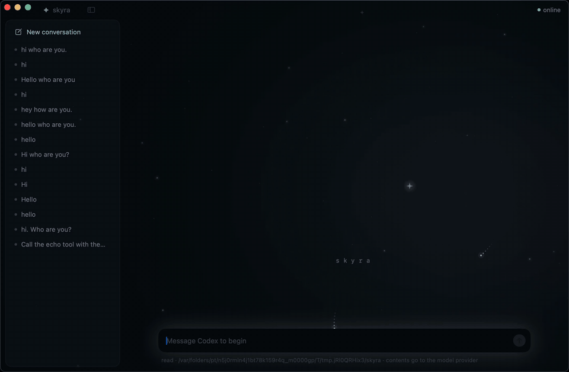
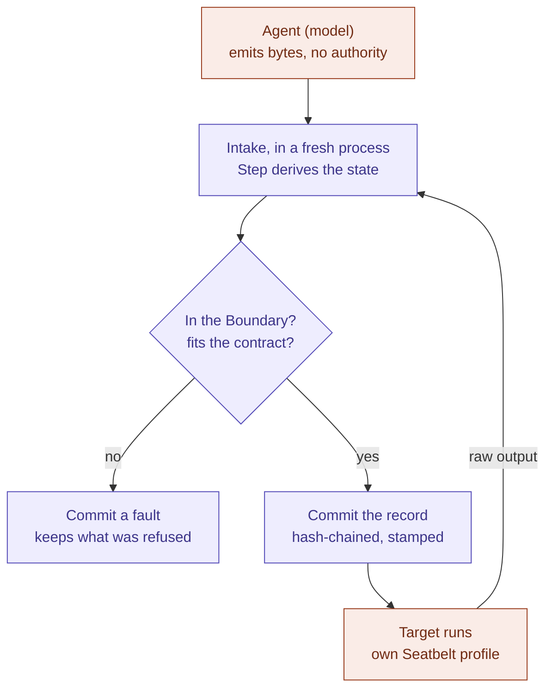

# Skyra

\*\* A Rectifier for Intelligence.



_The desktop app: real Codex reading this repo. Every tool call runs under the
granted boundary and is recorded._

A model's reasoning is alternating current: powerful, and different every
time. Skyra rectifies it into direct current: procedures that run the same
way every time, inside the Boundary you granted, with no model and no
approval.

Composability, memory and security are the open problems of agents: give an
agent enough power to be useful, and keep its behavior stable. Skyra has been
working on all three for nine months.

What if software wasn't written by agents, but left behind by them?

**Skyra is a a hierarchy of judged work that can consolidate accepted behavior into procedures**

**What's here:** a stateless runtime with a pure Go state machine, per-call
macOS sandboxes, hash-chained records checked by replay, and browser, terminal
and native macOS clients on one protocol. Codex and Claude both run under it.
An apprentice turns remembered traces into reusable procedures within the same
Boundary. The full argument: [`docs/grips-and-invariants.md`](docs/grips-and-invariants.md).

```sh
./install.sh && skyra demo   # every scenario, each ending in a replay check
```


## Three invariants

|       | Invariant                                           | What it means                                                                                                                                                                                                                 |
| ----- | --------------------------------------------------- | ----------------------------------------------------------------------------------------------------------------------------------------------------------------------------------------------------------------------------- |
| **1** | **The emitter is never the checker.**               | Whatever a model or tool outputs is untrusted bytes. A _different_ process interprets and commits it before anything acts on it.                                                                                              |
| **2** | **Authority only narrows, and the OS enforces it.** | Every step runs under a Boundary. A call shares its caller's unless it asks `system` to narrow it; nothing can widen one. The sandbox profile is _generated from the Boundary_, and the runtime's own state is always denied. |
| **3** | **Truth is derived, not stored.**                   | Only observations are stored. Everything else is re-derived by one pure function, so replaying the record chain from genesis _is_ the definition of correctness.                                                              |

## Run it (macOS, Go 1.25+, Node 20+)

```sh
./install.sh      # once: dependencies, build, puts `skyra` on your PATH
skyra             # chat with real Codex in the browser
skyra tui         # the same conversation in the terminal
skyra app         # Skyra.app: grant a workspace once, then chat
skyra demo        # every scenario, each ending in a replay check
skyra ask "Call the echo tool with the text hi, then tell me what it returned."
skyra test        # every test
```

Setup and troubleshooting: [`docs/startup-doc.md`](docs/startup-doc.md).
Packaging and releases: [`docs/PUBLISHING.md`](docs/PUBLISHING.md).

Each demo scenario proves one thing. Trimmed:

```text
══ agent: a continuation calls echo, waits, resumes ══
[inst 4b7d45a7] intake   committed 4b7d45a7  invoke echo {"text":"hello"}     ← derived from {"to":"echo",…}
[inst 2ae3f9ec] gather   every slot of 8828b46b discharged: committed resolve 9a3d13e2
replay: 7 records re-derived from genesis by step, byte-identical      ← invariant 3

══ echo probes .skyra/ from inside ══                     ← invariant 2
  return "hello [probe .skyra: read denied, write denied]"

══ echo addresses what is outside the Boundary ══          ← invariant 1
  fault (boundary, derived at intake): "shell" is not in reach
```

No target ever says "invoke", "return" or "fault". It prints operands, and
the runtime derives the state from where the emitter stands. A refused output
is still committed, **as a fault** that keeps what was refused.

## How a step works

There is no long-running controller. One `skyra` binary runs **once per
step**: read, authorize, one atomic write, execute, exit. All durable state
is a content-addressed, hash-chained record tree in `.skyra/`, so a crash
loses nothing that was committed and releases nothing that wasn't.



Every decision lives in one pure function, `machine.Step(state, event) →
(state, effects)`, and a test fails if it imports anything that touches the
OS. All I/O lives in `instance.Drive`, which decides nothing. Start with
[`controller/core/machine/machine.go`](controller/core/machine/machine.go);
the [controller README](controller/README.md) maps each design decision to
the line that implements it.

**Cost:** about 0.9 s more startup per turn than native Codex and 0.18 s per
tool call, fixed per step. Replay verifies about 47,000 records per second.
Method and caveats: [`docs/STARTUP-PER-TURN.md`](docs/STARTUP-PER-TURN.md).

## Where we are

|                                                                                                                                                                     | Status                                                                      |
| ------------------------------------------------------------------------------------------------------------------------------------------------------------------- | --------------------------------------------------------------------------- |
| Step protocol, custody handoff, content-addressed records, replay of every record                                                                                   | **built**                                                                   |
| Boundaries by hash, narrowing through `system.narrow`, sandbox rendered from the Boundary, `.skyra/` denied                                                         | **built**                                                                   |
| Codex and Claude as sessions of the service host ([49](docs/next/proposal/49-services-behind-adapters-proposal.md)), each under a deny-default profile              | **built**                                                                   |
| Conversations in browser, terminal and desktop: multi-turn, saved, replayable                                                                                       | **built**                                                                   |
| Fan-out, tail calls, delegation                                                                                                                                     | **built**                                                                   |
| Self-extension: `remember` a trace as a procedure, run it with no model and no approval, inside CEL refinements ([procedures](docs/design/procedures.md))           | **built**; scripted and with a fake Codex, not yet real Codex               |
| One tool trees: the invariant proven in Lean, a Go port checked against every vector Lean writes ([55](docs/next/proposal/55-one-tool-trees-invariant-proposal.md)) | **built**: `controller/apprentice/invariants`, `controller/apprentice/tree` |
| The tree machine: a pure `Step` over the whole tree ([56](docs/next/proposal/56-tree-machine-proposal.md))                                                          | decision layer **built**; `Step` and its shells next                        |
| Invariant 3 fully: records still store derived fields, checked by replay                                                                                            | known gap                                                                   |

## Whats proved

Trees with one target runs with claude

Trees of hieght > 1 are one or two changes away.

## Where we're going

The kernel gets out of the loop. It provisions the apprentice once, under the
root grant, and the apprentice runs the whole tree
([52](docs/next/proposal/52-kernel-provisions-apprentice-spawns-proposal.md)).

- **One tool per model** ([54](docs/next/proposal/54-one-tool-per-model-experiment-proposal.md)):
  a node's kind follows from its reach. With no contracts it is an effect,
  with one an invoke, with two or more a delegate. Work then falls into
  composable units by mechanism, not by prompts.
- **The invariant, proven** ([55](docs/next/proposal/55-one-tool-trees-invariant-proposal.md)):
  what may be passed, observed and returned is specified in Lean, and the Go
  agrees with it on every vector.
- **The tree machine** ([56](docs/next/proposal/56-tree-machine-proposal.md)):
  one pure `Step` drives 55's decisions, first on today's kernel and then on
  52's `skyra-spawn`, without changing `Step`.
- **Capabilities and information flow** ([53](docs/next/proposal/53-capabilities-and-information-flow-proposal.md)):
  where each kind of authority lives and who enforces it.

**The research question** ([`docs/next/research-question.md`](docs/next/research-question.md)):

> Can human approval move from every action to one grant of a Boundary, so an
> agent extends itself without asking, while matching a conventional runtime on
> cost and task success and containing strictly more?

## Layout

```text
skyra         the one command; `skyra help`
controller/   the stateless controller, and the apprentice (controller/apprentice)
frontend/     the browser UI
tui/          terminal client
desktop/      Skyra.app, the SwiftUI client
assets/       the README GIFs
docs/         setup, the why, the design (design/) and proposals (next/)
```

Everything older is preserved at the git tag `pre-cleanup`.
