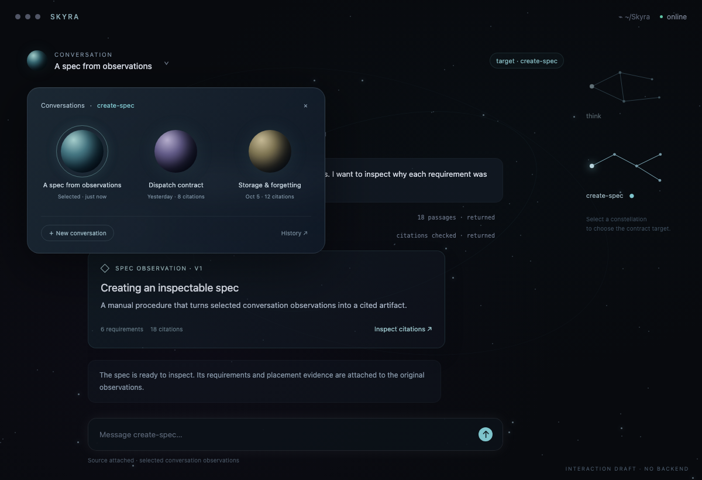
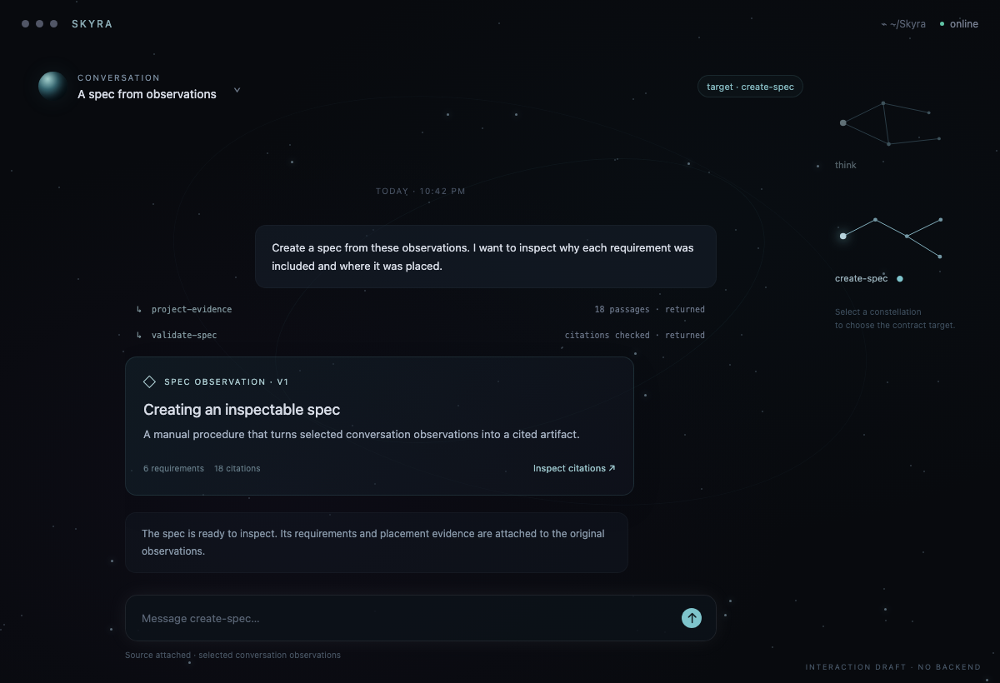

# Conversation planets: sidebar-free navigation

Date: 2026-10-06
Status: interaction draft, not implemented in the app.

User request: “get rid of the left sidebar where it shows procedures and
conversations. The conversations should display as ephemeral larger planets
drop down translucent thing.”

## Appearance

Keep the existing dark sky, restrained teal/violet light, constellation targets,
translucent chat panels, and floating-log behavior. Remove the permanent left
sidebar. Give the transcript the space it previously occupied.

Above the transcript, a small planet beside the current conversation title opens
a translucent dropdown. Conversations appear inside it as larger planets, with
titles and a small status/recency label below them. The selected planet has a thin
illuminated ring. Planets have stable positions and appearance so reopening the
picker does not move familiar conversations around.

The dropdown is ephemeral: it appears for navigation and disappears after a
selection, an outside click, or Escape. Conversation history itself remains
durable. Keep text labels; planet appearance alone is not an identifier.

## Interaction

- Click a constellation to select the contract target. The current draft opens
  that target's conversation picker at the same time; this is a proposed
  convenience, not an invocation.
- Click the conversation planet/title to reopen the picker for the selected
  target.
- Click a larger planet to open that conversation. Its existing procedure
  association is preserved.
- Use “New conversation” to start one under the selected target.
- Use “History” for conversations whose roots are no longer available.
- Preserve explicit source-observation attachments when switching targets. Do
  not silently substitute the newly selected conversation as the artifact's
  source.
- Retain deletion as an explicit context-menu action, with the existing
  confirmation behavior, rather than attaching deletion to a planet click.

Constellations own target selection. Planets own conversation selection. The
composer reflects the selected target, and the user actor carries that contract
selection to the adapter when submitting. Clicking either navigation element
does not execute a procedure or approve an artifact.

## Draft

Open [the interactive layout](mockups/conversation-planets.html). Click the
constellations, conversation planet, conversation cards, and citation inspector.
It uses sample content and has no backend connection.

With the picker open:

With the picker closed:

The mockup illustrates two authored roots, `think` and `create-spec`; it does not
change the running app or install `create-spec`.

## Implementation considerations

- Use the existing destination outlines and root-filtered conversation list as
  data sources; remove the sidebar without introducing another state model.
- Anchor the dropdown to the conversation control even when the log is floating.
  Clamp its bounds to the window and keep it clear of the composer.
- For longer lists, keep the dropdown height bounded with scrolling and add title
  search; do not draw an unbounded field of planets.
- Use keyboard navigation, visible focus, accessible labels, and reduced-motion
  behavior. Hover should be optional; opening and selecting must work by click
  and keyboard.
- Preserve separate target, displayed conversation, and source-evidence state.
- The selected artifact's citations remain inspectable in a separate transient
  panel, rather than overloading the conversation picker.
