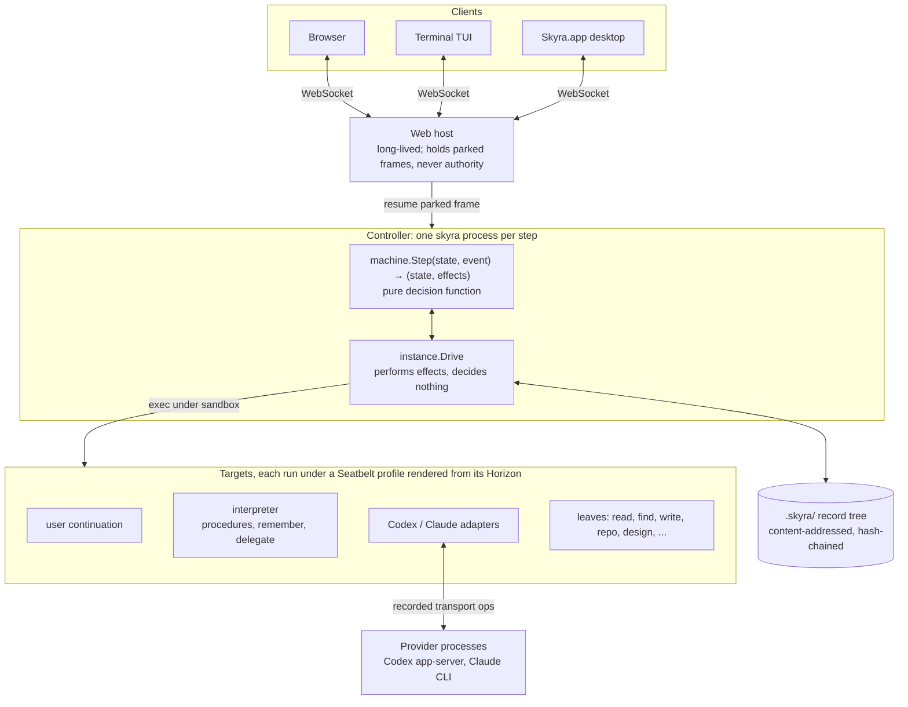

# Skyra: overall design

Date: 2026-10-10
Status: overview of the current design on `main`, with the proposed direction
marked separately. Where this document and a detailed spec disagree, the spec
and the code win; links to both are at the end.

## 1. The problem

Coding agents ask before every effect: *allow this command? this tool? this
file?* Each prompt is cheap; together they fail. People stop reading them,
approve by reflex, then switch to full-auto, which trades the prompts for
ambient authority: a shell, the whole workspace and the network, inside a
sandbox the agent reports about itself. This is **tool acceptance fatigue**.
Agents that write their own tools make it worse, because every new tool is new
code to approve.

Operating systems assume one trusted actor per user: the process. A user now
runs several semi-autonomous agents at once, and the OS has no principal for
them.

## 2. Thesis

> Skyra's principal is the **bounded, auditable agent**, not the process.

The human approves a boundary once (a **Horizon**), not every tool. The OS
enforces that boundary on every call, including calls to tools and procedures
the agent built for itself. Nothing created under a Horizon can hold more
authority than its creator, so building inside it needs no approval. The human
is asked only when work reaches past the Horizon.

The contribution is coupling, not invention. Permissions, plans and audit logs
exist already; Skyra makes them part of the execution graph instead of
bolting them on beside it.

**Research question:** can human approval move from every action to one grant
of a Horizon, so an agent extends itself without asking, while matching a
conventional runtime on cost and task success and containing strictly more?

## 3. Goals and non-goals

**Goals**

- One grant per task instead of a prompt per effect.
- OS-enforced containment derived from that grant, not self-reported.
- A complete, replayable record of what ran, under what authority, and why.
- Repeated work compiled into procedures that run without a model step.
- Model providers (Codex, Claude) as interchangeable, contained adapters.

**Non-goals (for now)**

- Distributed execution across hosts. It is a bet, not a driven requirement.
- Preventing misuse of a tool that was legitimately granted. A Horizon bounds
  blast radius; it does not judge intent.
- Platforms other than macOS (enforcement uses Seatbelt).

## 4. Three invariants

| | Invariant | Consequence |
|---|---|---|
| **1** | **The emitter is never the checker.** | Everything a model or tool emits is untrusted bytes. A different process interprets and commits it before anything acts on it. Nothing an agent says can put the system into a state. |
| **2** | **Authority only narrows, and the OS enforces it.** | Every step runs under a Horizon. A call shares its caller's Horizon unless it asks the room to narrow it; nothing widens one. The sandbox profile is rendered from the Horizon, and the runtime's own state is always denied. |
| **3** | **Truth is derived, not stored.** | Only observations are stored. Everything else is re-derived by one pure function, so replay from genesis is the definition of correctness. |

## 5. Architecture at a glance



There is no long-running server deciding anything. One `skyra` binary runs
**once per step**, then exits. All durable state is the record tree in
`.skyra/`. Long-lived processes (the web host, provider processes) hold
references and connections, never authority.

**Why stateless:** crash semantics. A crash before a step's single atomic write
means no effect was released; after it, intent is recorded and an external
effect may have an unknown outcome. There is no in-memory state to reconcile.

## 6. Core concepts

| Concept | Definition |
|---|---|
| **Horizon** | The authority an execution holds: its **reach** (targets and the contracts it may invoke on each) and OS grants (read/write paths, Mach services, sockets). Committed by hash; a child re-derives it before running. |
| **Contract** | A capability is identified by `(target, schema)`. A payload must structurally fit exactly one declared contract; none or several is a `contract` fault. |
| **Observation** | Bytes received: an invocation's input or a target's output. Stored by hash. |
| **Record** | The committed, hash-linked statement of one step: what was derived, from which observation, under which Horizon. |
| **Continuation** | A stateful participant (an LLM adapter, the user, the interpreter). It reads its input, its reach and every prior step, and prints one output. |
| **Leaf** | A tool. Runs under its caller's Horizon unless the caller narrows it. |
| **Room / `system`** | The syscalls every Horizon holds: `narrow`, `extend-reach`, `strand`. |
| **Procedure** | A durable composition of ordinary contract calls, run by the interpreter. |

**Operators are derived, never declared.** A target prints operands,
`{"to": address, "payload": JSON}`. The runtime derives the state from where
the emitter stands: addressing its own slot is a return, naming something in
reach is an invoke, anything else is a typed fault (`malformed`, `horizon`,
`contract`, `leaf`, `custody`). A refused output is still committed, as a fault
that keeps what was refused. A stamp means custody, not approval.

## 7. The step protocol

```text
INTAKE   receive unchecked bytes, interpret as operands, derive the state,
         commit a record, reply with its stamp (a hash)
RELEASE  the parent reads the record back, checks the stamp, derives and commits
         the child's Horizon, passes {hash + frame stack as directory fds}
         over a Unix socket (SCM_RIGHTS); the child re-derives the Horizon
EXECUTE  run the target under a Seatbelt profile rendered from that Horizon
HANDOFF  spawn a successor with the raw output; open a slot if it is an invoke;
         exit once the successor has stamped
SETTLE   a return or fault discharges the slot it answers, exactly once
GATHER   when every slot a waiting continuation opened is discharged,
         commit a resolve naming them all
CLAIM    exactly one sibling wins and resumes that continuation
```

- **Custody:** at every moment each piece of work is held by exactly one live
  process or one durable commit. A parent exits only after its successor stamps.
- **Fan-out:** a round opens all child slots before release and resumes once,
  in emission order, after every discharge.
- **Purity is enforced:** a test fails if `core/machine` imports anything that
  touches the OS, the tree or the network.

## 8. Authority

- A Horizon is one list. What an agent *cannot* touch is its complement.
- Ordinary calls inherit the caller's effective Horizon.
- `system.narrow` returns a **reference** to a restricted Horizon for one
  actor; invoking that reference runs the actor under the narrower authority.
  Asking for anything not held is a `horizon` fault.
- `system.extend-reach` lets an actor add a contract it already backs (for
  example a remembered procedure) to its own reach entry, with no approval: it
  rearranges authority already granted.
- The Seatbelt profile is rendered from the Horizon and denies by default.
  `.skyra/` is always denied, and exec is allowed only for the program being
  run. Binaries are pinned by SHA-256; a mismatch is a custody fault.
- Provider processes run under registered profiles with private state and a
  per-actor allowlisted egress proxy.

## 9. Records and replay

Every step is a content-addressed, hash-linked record. `skyra replay DIR`
re-derives every record from genesis (intake records, supervisor faults and
resolves alike) and checks the result is byte-identical. Version 2 histories
commit complete emissions, so replay also checks round coverage. Durable
acceptance receipts distinguish an accepted release from a proposed one.

Replay reconstructs *decisions*, not live processes. A host restart leaves
history inspectable and reports unfinished admitted work as `delivery-unknown`;
it does not revive providers or repeat external effects.

## 10. Procedures, remembering and delegation

The interpreter is an ordinary actor with its own state. Procedures are its
programming model.

- **Procedure language:** content-addressed nodes `{call, in, each, after}`,
  bindings by provenance, dynamic call targets, independent ready-node fan-out
  and procedure-to-procedure calls. It is a finite DAG.
- **Authored procedures:** versioned bundles validated and provisioned before
  genesis. `think` is one: it takes a `model` parameter (`codex` or `claude`),
  narrows, then calls the selected adapter.
- **Remember:** given an observation and the contract that requested it, the
  interpreter reads the **strand** (the recorded work beneath that invoke),
  compiles it into a procedure, and exposes it through `extend-reach`. Calling
  it later runs the remembered calls with no model step and no approval.
- **Refinements:** the originating model may write CEL refinements (type
  checked, cost bounded, validated against its own strand). Inside them the
  compiled body runs; outside them the interpreter falls back to the model.
- **Delegate:**
  `{"delegate":{"goal":"…","actor":"claude","tools":["read","find"]}}`.
  The child gets only its goal, a separate provider edge, and a tool ceiling no
  wider than the parent's. Ordinary child failures return
  `{failed:{kind,cause}}` so the parent can continue; integrity failures still
  stop execution.

**Recurrence is the resource.** The first run is expensive and loosely guarded
while the contract is discovered. The Nth run is cheap and tightly guarded,
because the remembered contract is a structural type that faults sharply on
deviation.

## 11. Provider adapters

Codex (app-server) and Claude (CLI) adapters are stateless continuations. They
translate a provider's tool requests into recorded invocations, and the
provider's transport operations (start, exchange, inspect, stop) are registered
targets. A native execution attempt interrupts the turn and returns to the
parent as an observation. Both adapters expose tools from the effective scoped
catalog.

## 12. Clients and ingress

Browser, terminal and desktop clients share one conversation protocol over
authenticated WebSockets with bounded framing and durable request admission.
The web host parks a frame and holds its stamp, never its authority; an
outside event resumes the frame and is checked like any other output. The user
side is itself a continuation whose steps are the transcript, so each
conversation is its lineage: saved, listed and replayable.

## 13. Code layout

```text
controller/core/      pure: contract, horizon, record, machine (the decision tree)
controller/runtime/   I/O around one step: instance, tree, replay, boot,
                      registry, handshake, custody, park, metric
controller/targets/   sandboxed programs: read, write, roots, user, browser, ...
controller/codex/     Codex adapter, transport, provider launch, fake app-server
controller/claude/    Claude adapter, bridge, provider, fake
controller/interp/    interpreter (own module, CEL): proc, remember, refine, types
controller/hosts/     long-lived hosts: web, repo, ideas
frontend/ tui/ desktop/   clients of one protocol
```

Imports run downward only: `core/` imports nothing outside itself, `runtime/`
builds on `core/`, and target programs share no code with either.

## 14. Status

**Built and tested:** the step protocol and custody handoff; content-addressed
records with full replay; derived operators and typed faults; one authority per
Horizon with narrowing and Seatbelt rendering; fan-out with join and claim;
ingress by parking; multi-turn conversations in three clients; the interpreter,
authored procedures, `remember`, refinements; bounded delegation for both
Codex and Claude.

**Known gaps (stated plainly):**

- **Provider authority is not uniformly Horizon-derived.** Provider launch
  profiles replace the generic deny-default profile. Codex parents may use
  native image viewing and web search without per-read records; Claude's
  profile starts from `allow default` minus the runtime floor. "Every effect is
  recorded" and "every process holds only Horizon-rendered authority" are goals,
  not current guarantees.
- **The kernel still knows about agents.** `Horizon.Agent`, `WorkTools`,
  `Delegated` and `system.agent-context` live in core.
- **Recovery trails reconstruction.** Accepted-tree reads exist; user-owned
  checkpoints and full conversation recovery are not wired in.
- **The procedure language** has no general conditionals, fault handlers or
  event loop; bundle migrations do not exist.
- **Remembering with a real provider** is offered but not yet established
  beyond scripted and fake-provider runs.
- **Context growth:** Think's context grows with turns; no compaction.

## 15. Direction (proposed, not implemented)

1. **Separate authority from adapter configuration**
   ([Horizon concern spec](../../HORIZON-CONCERNS-SPEC.md)). Delegation becomes
   purely the interpreter's procedure, not a Horizon mode. Model configuration
   and tool catalogs move into adapter contracts. The kernel restricts generic
   `(target, contract)` capabilities without knowing providers, models or tool
   labels. Equivalent enforcement must exist before the old fields are removed.
2. **Resource lifetime by a lifecycle actor.** Start, reuse, retention and
   shutdown of provider processes move to a dedicated actor; the kernel supplies
   generic ownership and custody mechanisms. Normal authorized invocation stays
   the only communication path, and endpoint reservation must be atomic and
   scoped.
3. **The runtime speaks hashes**
   ([content identity](os-primitives-and-content-identity.md)). Reach becomes a
   set of binary hashes with their schemas; actors resolve names like `claude`
   to hashes as recorded observations. Records name both input and output
   observations explicitly. A provider update is a new binary that must be
   granted. The first change: hash the Claude binary actually launched instead
   of resolving it from `PATH`.
4. **Visible delegation** in client activity, with parent/child correlation.
5. **Procedure-native conversations** built on user-owned root/frontier
   checkpoints.

## 16. Evaluation

Baseline: the same models in their native approval modes (ask on request, and
full auto). Measures:

- human interruptions per task;
- task success;
- runtime overhead and cost;
- agent-built tools and procedures that run with zero approvals, and model
  calls they displace;
- containment of the agent and its tools against an adversarial suite.

`skyra metric DIR` already reads procedure and fallback counts from records;
the comparative evaluation is future work.

## 17. Further reading

| Topic | Source |
|---|---|
| Project introduction and demo | [README](../../README.md) |
| Why: the six grips and the invariants | [grips-and-invariants.md](../grips-and-invariants.md) |
| Current state in detail | [summary.md](../summary.md) |
| Controller internals, package by package | [controller/README.md](../../controller/README.md) |
| Original controller spec (D1–D9) | [docs/design/](../design/) |
| Capability notes and proposals | [docs/next/](../next/) |
| Procedures and remembering | [next/32-procedures.md](../next/32-procedures.md) |
| Delegation semantics | [DELEGATION.md](../../DELEGATION.md) |
| Research question | [next/research-question.md](../next/research-question.md) |
