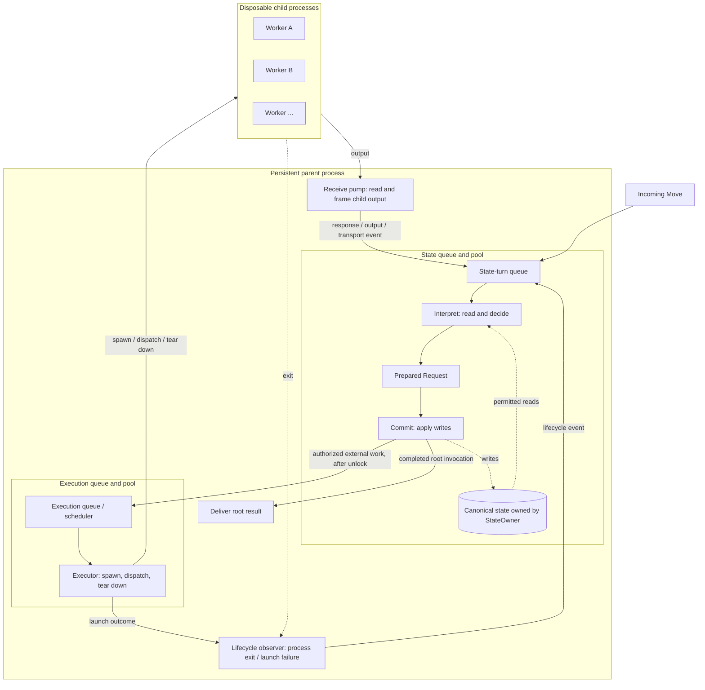

# Persistent parent and separate state/execution pools

Date: 2026-09-20

Status: High-level design sketch from discussion. No implementation changes.

## The shape

One persistent parent process holds canonical state and manages disposable child
processes. Inside that parent, state work and execution work have separate queues
and processing resources.

The state side reads, decides, and commits. The execution side performs the
authorized external work, including spawning and tearing down children. Worker
responses return to the state side through a receive pump.



The child boxes represent concurrent execution shells, not a fixed set of
long-lived processes. The receive pump and lifecycle observer name responsibilities;
their exact goroutine/pool arrangement is still open.

## Two pools in one process

| Component | Responsibility |
|---|---|
| State queue and pool | Process Moves and execution events through interpret/commit turns. |
| StateOwner | Own canonical records, authority, invocation relationships, and continuation state. |
| Execution queue and pool | Schedule authorized work and manage child execution outside state locks. |
| Receive pump | Read child output, frame it, and submit events bound to the child's assigned execution identity. |
| Lifecycle observer | Report launch and exit outcomes to the state side. |
| Disposable child | Perform its assigned request and report an outcome. |

The initial state pool can have **one worker**, preserving the single-writer
model. The execution pool can run multiple jobs concurrently. State-side
parallelism can be considered later without coupling its pool size to execution
concurrency.

Calling the parent the "StateOwner process" describes where state lives. It does
not require the StateOwner component itself to perform OS process management.
StateOwner, executor, and receive pump remain separate responsibilities inside
that process.

## A state turn stays together

```text
lock what the turn needs
    interpret: read, resolve, validate, decide
        -> prepare Request
    commit(Request): apply the prepared writes
unlock
    hand authorized external work to execution
```

Reads and writes belong to the same state turn, with the lock held across both.
They are not separate read and write pools. The prepared Request is passed
directly from interpret to commit; it does not wait in an independent commit
queue where its assumptions could become stale.

The state-turn queue holds incoming work to interpret. The execution queue holds
work authorized by a completed commit. Those are different kinds of work even
if their final struct names remain undecided.

## Disposable workers, retained continuity

The persistent parent keeps the logical invocation and its continuation state.
A child process is a request/response shell and need not remain alive just to
wait for subsequent work.

If a worker reports that a child result is needed, the parent can record the
dependency and let that worker exit. When the result arrives, a fresh worker can
continue from the committed state. The response/yield contract must make that
state transfer explicit; a process's private memory cannot be assumed to survive.

Logical invocation identity therefore outlives an individual worker execution.
Each worker needs its own temporary execution handle so late output from a
retired worker cannot act as output from its replacement.

The parent owns cleanup. A worker may exit after responding, or the executor may
need to terminate it. Response handling, exit observation, and resource cleanup
must be coordinated; the diagram does not prescribe their precise ordering.
Neither EOF nor process exit alone establishes a successful invocation result.

## Where policy fits

Surface-specific semantics describe retryability, rate-limit scopes, timeouts,
and concurrency requirements. Interpretation evaluates those rules against
canonical state; commit records the decision and any required reservations.

The execution scheduler carries out admitted work and arranges wake-ups for
deferred work. A wake-up that needs a fresh state-dependent decision returns
through the state queue. Rate-limit or retry delays should not occupy a child
process merely to wait.

Policy's concrete interface is a later design step. Shared budgets may span
multiple Surfaces, and a continuation is distinct from retrying an operation.

## Questions to dig into next

1. What are the exact state-turn input, prepared Request, and execution-job structs?
2. What does a worker return when it completes, fails, or yields for a dependency?
3. How are logical invocations, worker executions, and retries identified?
4. How does the receive pump coordinate output, process exit, backpressure, and cleanup?
5. How are rate limits, concurrency reservations, and retry decisions represented?
6. Where do provider connections live when a Surface requires a persistent session?

This sketch assumes a long-lived parent, not crash durability. Persistence and
recovery remain separate work. The queues also need a backpressure design that
avoids the existing interpreter self-enqueue deadlock.

## Related

- [Detailed worker, receive-pump, and policy proposal](disposable-workers-state-turns-and-execution-policy.md)
- [Interpret and commit discipline](improvements.md)
- [Surface profiles](surface.md)
- [Invocation and Possibility isolation](invocation-cactus-and-possibility-isolation.md)
