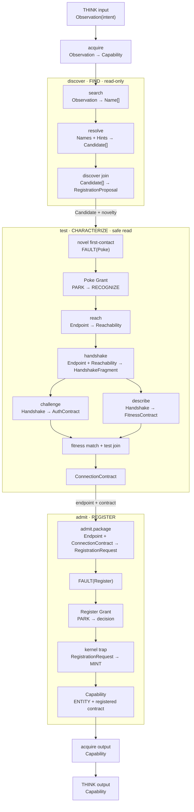

# THINK → acquire — child input/output contracts

**Date:** 2026-08-24  
**Status:** v10 research artifact. These are the semantic JSON contracts exercised by the passing
happy path. They describe `Observation.Value`; the engine envelope is shown first.

## The execution drawing



The implementation compresses one logical boundary: the `resolve` runner currently attaches the
novelty verdict and returns `RegistrationProposal` directly, so the logical `Candidate[] → proposal`
discover join is represented by the tail of that move. The contract below prints both the logical
child contract and the actual v10 move return rather than hiding that seam.

## Shared engine return envelope

Every child returns an outcome beside an observation. On `SUCCESS`, `observation.value` must satisfy
the child's output contract. Entity observations are stamped before their contract is checked.

```json
{
  "$id": "skyra://contracts/step-result",
  "type": "object",
  "required": ["outcome", "observation"],
  "properties": {
    "outcome": { "enum": ["SUCCESS", "FAILURE", "NOTYET", "FAULT"] },
    "observation": {
      "type": ["object", "null"],
      "properties": {
        "value": {},
        "segment": {
          "type": "object",
          "required": ["by"],
          "properties": { "by": { "type": "string" } }
        }
      }
    },
    "fault": { "$ref": "#/$defs/FaultValue" }
  }
}
```

## 1 · THINK

THINK is broader than acquisition in the full design. In this v10 slice, its executed child is
`acquire`, so its return contract is the acquired capability.

Input contract:

```json
{
  "$id": "skyra://contracts/think/input",
  "type": "object",
  "required": ["intent"],
  "properties": { "intent": { "$ref": "#/$defs/Observation" } }
}
```

Output contract:

```json
{
  "$id": "skyra://contracts/think/output",
  "$ref": "#/$defs/Capability"
}
```

Happy-path value:

```json
{
  "name": "endpoint:dns:203.0.113.7:443/tcp/stream",
  "endpoint": {
    "namespace": "dns",
    "address": "203.0.113.7:443",
    "triple": { "domain": "inet", "type": "stream", "protocol": "tcp" }
  },
  "block": "ENTITY",
  "contract": { "$ref": "happy-path ConnectionContract below" }
}
```

## 2 · acquire

Input contract:

```json
{
  "$id": "skyra://contracts/acquire/input",
  "type": "object",
  "required": ["intent"],
  "properties": { "intent": { "$ref": "#/$defs/Observation" } }
}
```

Output contract:

```json
{
  "$id": "skyra://contracts/acquire/output",
  "$ref": "#/$defs/Capability"
}
```

The output value is the same concrete Capability printed for THINK. It is returned only after the
registry contains the same endpoint and `ConnectionContract` in the Entity block.

## 3 · discover

Input contract:

```json
{
  "$id": "skyra://contracts/discover/input",
  "type": "object",
  "required": ["intent"],
  "properties": { "intent": { "$ref": "#/$defs/Observation" } }
}
```

Output contract:

```json
{
  "$id": "skyra://contracts/discover/output",
  "$ref": "#/$defs/RegistrationProposal"
}
```

Happy-path value:

```json
{
  "candidates": [
    {
      "name": "weather.example",
      "endpoint": {
        "namespace": "dns",
        "address": "203.0.113.7:443",
        "triple": { "domain": "inet", "type": "stream", "protocol": "tcp" }
      },
      "novelty": {
        "known": false,
        "history": { "note": "no registry history" }
      }
    }
  ]
}
```

### discover.search

Input contract:

```json
{
  "$id": "skyra://contracts/search/input",
  "$ref": "#/$defs/Observation"
}
```

Output contract and value:

```json
{
  "$id": "skyra://contracts/search/output",
  "type": "array",
  "items": { "type": "string" },
  "value_in_this_run": ["weather.example"]
}
```

### discover.resolve

Logical input contract:

```json
{
  "$id": "skyra://contracts/resolve/input",
  "type": "object",
  "required": ["names", "hints"],
  "properties": {
    "names": { "type": "array", "items": { "type": "string" }, "minItems": 1 },
    "hints": { "$ref": "#/$defs/ResolveHints" }
  }
}
```

Logical output contract:

```json
{
  "$id": "skyra://contracts/resolve/output",
  "type": "array",
  "items": { "$ref": "#/$defs/Candidate" }
}
```

Actual v10 move return contract: `RegistrationProposal`. The resolver attaches the `Registry.Known`
verdict and performs discover's one-field join in the same runner.

```json
{
  "names": ["weather.example"],
  "hints": {
    "service": "https",
    "triple": { "domain": "inet", "type": "stream", "protocol": "tcp" }
  },
  "returned": {
    "candidates": [
      {
        "name": "weather.example",
        "endpoint": {
          "namespace": "dns",
          "address": "203.0.113.7:443",
          "triple": { "domain": "inet", "type": "stream", "protocol": "tcp" }
        },
        "novelty": { "known": false, "history": { "note": "no registry history" } }
      }
    ]
  }
}
```

## 4 · test

`intent` is an inherited dataflow operand used by fitness matching; it carries no authority.

Input contract:

```json
{
  "$id": "skyra://contracts/test/input",
  "type": "object",
  "required": ["candidate", "intent"],
  "properties": {
    "candidate": { "$ref": "#/$defs/Candidate" },
    "intent": { "$ref": "#/$defs/Observation" }
  }
}
```

Output contract:

```json
{
  "$id": "skyra://contracts/test/output",
  "$ref": "#/$defs/ConnectionContract"
}
```

### test.reach

```json
{
  "input_contract": { "$ref": "#/$defs/Endpoint" },
  "output_contract": { "$ref": "#/$defs/Reachability" },
  "output_in_this_run": { "up": true, "why": "mock connect answered" }
}
```

### test.handshake

```json
{
  "input_contract": {
    "type": "object",
    "required": ["endpoint", "reachability"],
    "properties": {
      "endpoint": { "$ref": "#/$defs/Endpoint" },
      "reachability": { "$ref": "#/$defs/Reachability" }
    }
  },
  "output_contract": { "$ref": "#/$defs/HandshakeFragment" },
  "output_in_this_run": {
    "transport": {
      "triple": { "domain": "inet", "type": "stream", "protocol": "tcp" },
      "port": 443,
      "tls": true,
      "alpn": "h2"
    },
    "identity": { "cert_host": "weather.example" }
  }
}
```

### test.challenge

```json
{
  "input_contract": {
    "type": "object",
    "required": ["endpoint", "handshake"],
    "properties": {
      "endpoint": { "$ref": "#/$defs/Endpoint" },
      "handshake": { "$ref": "#/$defs/HandshakeFragment" }
    }
  },
  "output_contract": { "$ref": "#/$defs/AuthContract" },
  "output_in_this_run": {
    "method": "bearer",
    "credential_type": "oauth2-token",
    "verified": false
  }
}
```

`verified: false` is load-bearing: challenge learned the credential type but never obtained or used a
credential.

### test.describe

```json
{
  "input_contract": {
    "type": "object",
    "required": ["endpoint", "handshake"],
    "properties": {
      "endpoint": { "$ref": "#/$defs/Endpoint" },
      "handshake": { "$ref": "#/$defs/HandshakeFragment" }
    }
  },
  "output_contract": { "$ref": "#/$defs/FitnessContract" },
  "output_in_this_run": {
    "operation": "GET /forecast",
    "request": { "name": "ForecastRequest", "required_fields": ["city"] },
    "response": {
      "name": "ForecastReply",
      "required_fields": ["forecast", "temperature_c"]
    }
  }
}
```

### test.fitness-match

This is a parent judgment, not a probe leaf.

```json
{
  "input_contract": {
    "type": "object",
    "required": ["intent", "described_fitness"],
    "properties": {
      "intent": { "$ref": "#/$defs/Observation" },
      "described_fitness": { "$ref": "#/$defs/FitnessContract" }
    }
  },
  "output_contract": {
    "type": "object",
    "required": ["selected", "fitness"],
    "properties": {
      "selected": { "type": "boolean" },
      "fitness": { "$ref": "#/$defs/FitnessContract" }
    }
  },
  "output_in_this_run": {
    "selected": true,
    "fitness": { "operation": "GET /forecast" }
  }
}
```

### test.join

Input contract:

```json
{
  "type": "object",
  "required": ["reach", "handshake", "auth", "fitness", "intent"],
  "properties": {
    "reach": { "$ref": "#/$defs/Reachability" },
    "handshake": { "$ref": "#/$defs/HandshakeFragment" },
    "auth": { "$ref": "#/$defs/AuthContract" },
    "fitness": { "$ref": "#/$defs/FitnessContract" },
    "intent": { "$ref": "#/$defs/Observation" }
  }
}
```

Output contract and happy-path value:

```json
{
  "transport": {
    "triple": { "domain": "inet", "type": "stream", "protocol": "tcp" },
    "port": 443,
    "tls": true,
    "alpn": "h2"
  },
  "identity": { "cert_host": "weather.example" },
  "auth": {
    "method": "bearer",
    "credential_type": "oauth2-token",
    "verified": false
  },
  "fitness": {
    "operation": "GET /forecast",
    "request": { "name": "ForecastRequest", "required_fields": ["city"] },
    "response": {
      "name": "ForecastReply",
      "required_fields": ["forecast", "temperature_c"]
    }
  },
  "success": { "says": "HTTP 200 with forecast and temperature_c" },
  "partial": true
}
```

## 5 · admit

Input contract:

```json
{
  "$id": "skyra://contracts/admit/input",
  "type": "object",
  "required": ["endpoint", "contract"],
  "properties": {
    "endpoint": { "$ref": "#/$defs/Endpoint" },
    "contract": { "$ref": "#/$defs/ConnectionContract" }
  }
}
```

Output contract:

```json
{
  "$id": "skyra://contracts/admit/output",
  "$ref": "#/$defs/Capability"
}
```

### admit.package

This child may construct data but cannot originate authority.

```json
{
  "input_contract": {
    "type": "object",
    "required": ["endpoint", "contract"],
    "properties": {
      "endpoint": { "$ref": "#/$defs/Endpoint" },
      "contract": { "$ref": "#/$defs/ConnectionContract" }
    }
  },
  "output_contract": { "$ref": "#/$defs/RegistrationRequest" },
  "output_in_this_run": {
    "endpoint": {
      "namespace": "dns",
      "address": "203.0.113.7:443",
      "triple": { "domain": "inet", "type": "stream", "protocol": "tcp" }
    },
    "block": "ENTITY",
    "contract": { "$ref": "happy-path ConnectionContract above" }
  }
}
```

### admit.register

The ordinary output is interrupted by a typed Register fault. After privilege decides and the kernel
mints, `Recognize` re-drives this child and it returns the registered Capability.

```json
{
  "input_contract": { "$ref": "#/$defs/RegistrationRequest" },
  "fault_contract": { "$ref": "#/$defs/FaultValue" },
  "output_contract": { "$ref": "#/$defs/Capability" },
  "output_in_this_run": {
    "name": "endpoint:dns:203.0.113.7:443/tcp/stream",
    "endpoint": {
      "namespace": "dns",
      "address": "203.0.113.7:443",
      "triple": { "domain": "inet", "type": "stream", "protocol": "tcp" }
    },
    "block": "ENTITY",
    "contract": { "$ref": "happy-path ConnectionContract above" }
  }
}
```

## Boundary contracts (not THINK children)

These are included because they cut the child trace twice.

### Novel first-contact: FaultValue → Poke Grant

```json
{
  "fault": {
    "target": "skyra://privilege/user",
    "endpoint": "203.0.113.7:443",
    "kind": "Poke",
    "scope": {
      "endpoint": "203.0.113.7:443",
      "purpose": "weather in San Francisco",
      "action": "Poke"
    }
  },
  "grant": {
    "kind": "Poke",
    "subject": "203.0.113.7:443",
    "scope": {
      "endpoint": "203.0.113.7:443",
      "purpose": "weather in San Francisco",
      "action": "Poke"
    },
    "minted": null
  }
}
```

### Admission: FaultValue → Register Grant → kernel Capability

```json
{
  "fault": {
    "target": "skyra://privilege/user",
    "endpoint": "203.0.113.7:443",
    "kind": "Register",
    "scope": {
      "endpoint": "203.0.113.7:443",
      "purpose": "weather in San Francisco",
      "action": "Register"
    },
    "registration": { "$ref": "#/$defs/RegistrationRequest" }
  },
  "privilege_decision": "allow-register",
  "kernel_input": { "$ref": "#/$defs/RegistrationRequest" },
  "kernel_output": { "$ref": "#/$defs/Capability" },
  "grant": {
    "kind": "Register",
    "subject": "203.0.113.7:443",
    "minted": { "$ref": "#/$defs/Capability" }
  }
}
```

## Canonical JSON shapes (`$defs`)

These definitions expand the references used above. JSON field names are the external contract
spelling; the throwaway Go structs use exported Go field names internally.

```json
{
  "$defs": {
    "Observation": {
      "type": "object",
      "required": ["content", "segment"],
      "properties": {
        "content": { "type": "string" },
        "segment": {
          "type": "object",
          "required": ["by"],
          "properties": { "by": { "type": "string" } }
        }
      }
    },
    "Triple": {
      "type": "object",
      "required": ["domain", "type", "protocol"],
      "properties": {
        "domain": { "type": "string" },
        "type": { "type": "string" },
        "protocol": { "type": "string" }
      }
    },
    "Endpoint": {
      "type": "object",
      "required": ["namespace", "address", "triple"],
      "properties": {
        "namespace": { "type": "string" },
        "address": { "type": "string" },
        "triple": { "$ref": "#/$defs/Triple" }
      }
    },
    "ResolveHints": {
      "type": "object",
      "required": ["service", "triple"],
      "properties": {
        "service": { "type": "string" },
        "triple": { "$ref": "#/$defs/Triple" }
      }
    },
    "NoveltyVerdict": {
      "type": "object",
      "required": ["known", "history"],
      "properties": {
        "known": { "type": "boolean" },
        "history": {
          "type": "object",
          "required": ["note"],
          "properties": { "note": { "type": "string" } }
        }
      }
    },
    "Candidate": {
      "type": "object",
      "required": ["name", "endpoint", "novelty"],
      "properties": {
        "name": { "type": "string" },
        "endpoint": { "$ref": "#/$defs/Endpoint" },
        "novelty": { "$ref": "#/$defs/NoveltyVerdict" }
      }
    },
    "RegistrationProposal": {
      "type": "object",
      "required": ["candidates"],
      "properties": {
        "candidates": {
          "type": "array",
          "minItems": 1,
          "items": { "$ref": "#/$defs/Candidate" }
        }
      }
    },
    "Reachability": {
      "type": "object",
      "required": ["up", "why"],
      "properties": {
        "up": { "type": "boolean" },
        "why": { "type": "string" }
      }
    },
    "Contract": {
      "type": "object",
      "required": ["name", "required_fields"],
      "properties": {
        "name": { "type": "string" },
        "required_fields": { "type": "array", "items": { "type": "string" } }
      }
    },
    "TransportContract": {
      "type": "object",
      "required": ["triple", "port", "tls", "alpn"],
      "properties": {
        "triple": { "$ref": "#/$defs/Triple" },
        "port": { "type": "integer", "minimum": 1, "maximum": 65535 },
        "tls": { "type": "boolean" },
        "alpn": { "type": "string" }
      }
    },
    "HandshakeFragment": {
      "type": "object",
      "required": ["transport", "identity"],
      "properties": {
        "transport": { "$ref": "#/$defs/TransportContract" },
        "identity": {
          "type": "object",
          "required": ["cert_host"],
          "properties": { "cert_host": { "type": "string" } }
        }
      }
    },
    "AuthContract": {
      "type": "object",
      "required": ["method", "credential_type", "verified"],
      "properties": {
        "method": { "type": "string" },
        "credential_type": { "type": "string" },
        "verified": { "type": "boolean" }
      }
    },
    "FitnessContract": {
      "type": "object",
      "required": ["operation", "request", "response"],
      "properties": {
        "operation": { "type": "string" },
        "request": { "$ref": "#/$defs/Contract" },
        "response": { "$ref": "#/$defs/Contract" }
      }
    },
    "ConnectionContract": {
      "type": "object",
      "required": ["transport", "identity", "auth", "fitness", "success", "partial"],
      "properties": {
        "transport": { "$ref": "#/$defs/TransportContract" },
        "identity": {
          "type": "object",
          "required": ["cert_host"],
          "properties": { "cert_host": { "type": "string" } }
        },
        "auth": { "$ref": "#/$defs/AuthContract" },
        "fitness": { "$ref": "#/$defs/FitnessContract" },
        "success": {
          "type": "object",
          "required": ["says"],
          "properties": { "says": { "type": "string" } }
        },
        "partial": { "type": "boolean" }
      }
    },
    "RegistrationRequest": {
      "type": "object",
      "required": ["endpoint", "contract", "block"],
      "properties": {
        "endpoint": { "$ref": "#/$defs/Endpoint" },
        "contract": { "$ref": "#/$defs/ConnectionContract" },
        "block": { "const": "ENTITY" }
      }
    },
    "Capability": {
      "type": "object",
      "required": ["name", "endpoint", "contract", "block"],
      "properties": {
        "name": { "type": "string" },
        "endpoint": { "$ref": "#/$defs/Endpoint" },
        "contract": { "$ref": "#/$defs/ConnectionContract" },
        "block": { "const": "ENTITY" }
      }
    },
    "FaultValue": {
      "type": "object",
      "required": ["target", "endpoint", "kind", "scope"],
      "properties": {
        "target": { "const": "skyra://privilege/user" },
        "endpoint": { "$ref": "#/$defs/Endpoint" },
        "kind": { "enum": ["Poke", "Register"] },
        "scope": {
          "type": "object",
          "required": ["endpoint", "purpose", "action"],
          "properties": {
            "endpoint": { "$ref": "#/$defs/Endpoint" },
            "purpose": { "type": "string" },
            "action": { "enum": ["Poke", "Register"] }
          }
        },
        "registration": {
          "oneOf": [
            { "$ref": "#/$defs/RegistrationRequest" },
            { "type": "null" }
          ]
        }
      }
    }
  }
}
```

## The contract chain in one line

```text
Observation
  → Name[]
  → RegistrationProposal<Candidate{Endpoint, NoveltyVerdict}>
  → [Reachability, HandshakeFragment, AuthContract, FitnessContract]
  → ConnectionContract
  → RegistrationRequest                         (data; acquire may construct)
  → FAULT(Register) → privilege decision
  → kernel MINT
  → Capability{Endpoint, ConnectionContract, Entity}  (authority; kernel alone originates)
```

