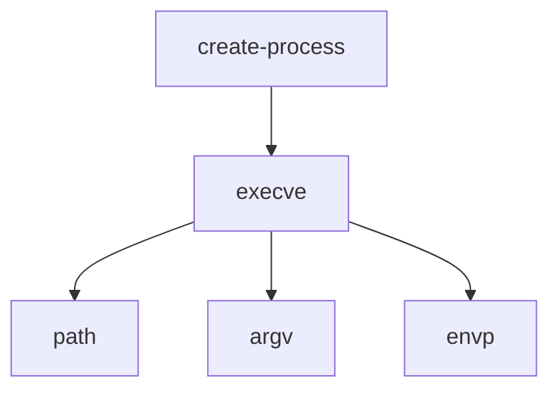
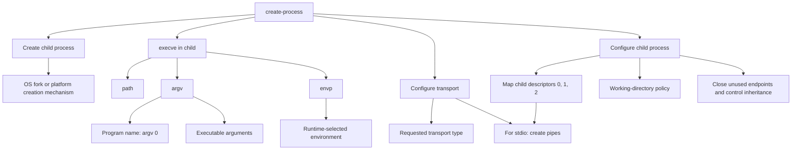

# create-process dependency map

Date: 2026-09-19  
Status: Conceptual dependency map; concrete Surface boundaries remain under discussion.

OS means the underlying operating system. Runtime means Skyra's runtime.

## Core relationship

`create-process` depends on executable loading through `execve`. In turn,
`execve` requires `path`, `argv`, and `envp`.



Here, a dependency can be either an operation or required input data. `execve`
is an OS operation; `path`, `argv`, and `envp` are its input dependencies, not
themselves syscalls. Arrows point from a dependent to what it requires; they do
not specify execution order.

## Expanded process and transport dependencies

Exec loads a program into an existing process. To keep the runtime alive,
`create-process` also needs child-process creation and transport setup. This map
shows the conceptual fork/exec route; a spawn wrapper may package those operations.



The executable path, arguments, and transport type come from the proposed Surface
input. The environment and working-directory policies still need to be defined.

## Execution order and returned observation

Dependency structure and execution order are different views. For stdio, the
conceptual order is:

```text
Runtime: interpret and commit the authorized create-process request
    ↓
Execution: create pipes and create the child process
    ├─ Child: configure descriptors and working directory
    │         → execve(path, argv, envp)
    │         → executable runs
    └─ Parent: retain its pipe endpoints and process reference
              → establish launch/setup outcome
    ↓
Runtime: egress interpret and commit publish the outcome
    ↓
Return observation {
    processHandle
    transportHandle
}
```

A successful `execve` does not return to the child's old program. The parent-side
launcher reports the creation outcome; the runtime registers the resources and
returns their handles. A successful launch is not an application readiness check.
Failures during creation, exec, or transport setup require cleanup and a failure
outcome rather than a successful observation containing partially usable handles.

See the [create-process contract](create-process.md) and
[OS capability proposal](../syscalls.md).
