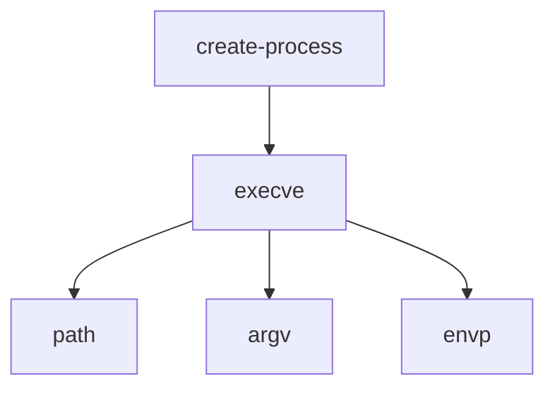
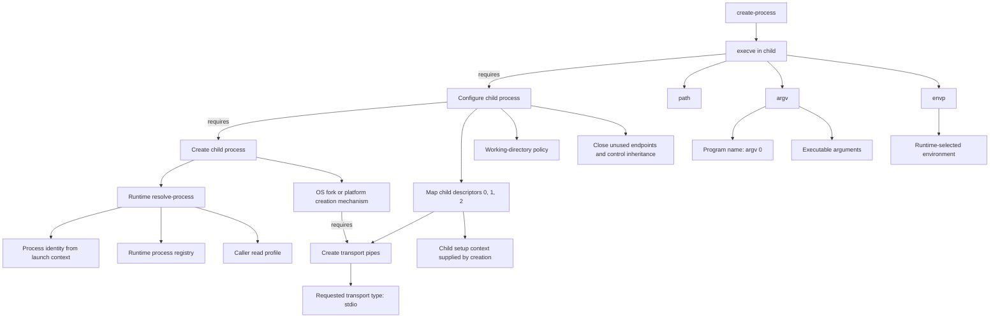
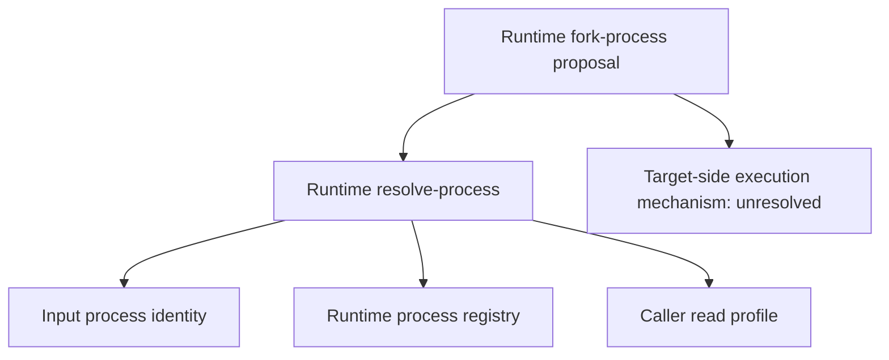
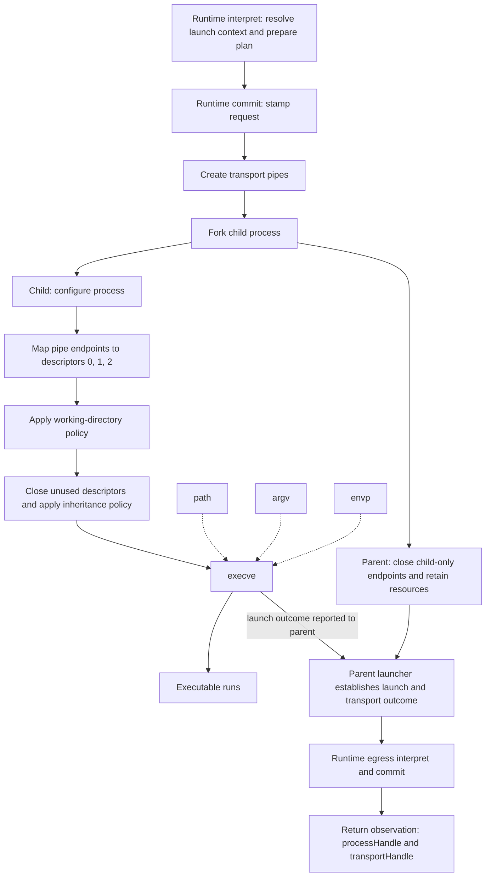

# create-process dependency map

Date: 2026-09-19  
Status: Conceptual dependency map; concrete Surface boundaries remain under discussion.

OS means the underlying operating system. Runtime means Skyra's runtime.

## Core relationship

`create-process` depends on executable loading through `execve`. In turn,
`execve` requires `path`, `argv`, and `envp`.

Here, a dependency can be either an operation or required input data. `execve`
is an OS operation; `path`, `argv`, and `envp` are its input dependencies, not
themselves syscalls. Arrows point from a dependent to what it requires; they do
not specify execution order.

## Expanded process and transport dependencies

Exec loads a program into an existing process. To keep the runtime alive,
`create-process` also needs child-process creation and transport setup. This map
shows the conceptual fork/exec route; a spawn wrapper may package those operations.
In this dependency view, `requires` arrows point backward to prerequisites:
exec requires completed child configuration, configuration requires a created
child, and fork requires the transport pipes to have been prepared for inheritance.

The executable path, arguments, and transport type come from the proposed Surface
input. The environment and working-directory policies still need to be defined.
Descriptor mapping uses the newly created child's setup context; it does not
perform another `resolve-process` lookup or modify a remote process by PID.

## Runtime process-resolution dependency

`resolve-process` is the runtime syscall Surface's process-table lookup. It runs
within interpretation and supplies a resolved record/binding to the operation.
The process identity may be a registered OS PID or runtime process handle.

For ordinary `create-process`, resolution concerns the runtime's launch context;
macOS `fork()` already identifies its caller implicitly. For a Surface targeting
another process, lookup alone is insufficient: that process must cooperate to
fork its own execution state. This map does not imply an OS `fork(pid)` call.

## Execution order and returned observation

Unlike the dependency view above, the solid arrows here point forward in execution
order. After fork, child setup and parent-side resource handling run in their
respective processes. Dashed arrows show configuration inputs.

The ordering among individual child-configuration actions is illustrative; the
required boundary is that all child setup completes before `execve`. The launch
outcome edge is parent-side reporting, not a successful return from `execve`.

A successful `execve` does not return to the child's old program. The parent-side
launcher reports the creation outcome; the runtime registers the resources and
returns their handles. A successful launch is not an application readiness check.
Failures during creation, exec, or transport setup require cleanup and a failure
outcome rather than a successful observation containing partially usable handles.

See the [create-process contract](create-process.md) and
[runtime syscall Surfaces](../skyra-syscall-surface.md) and
[macOS facilities](../mac-syscall-surface.md).
