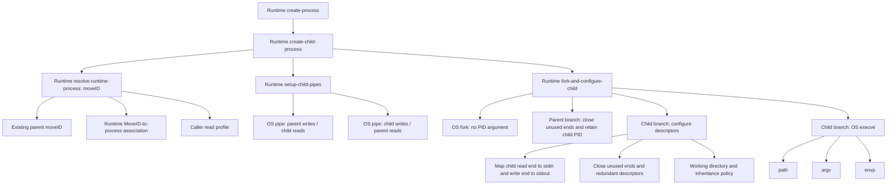
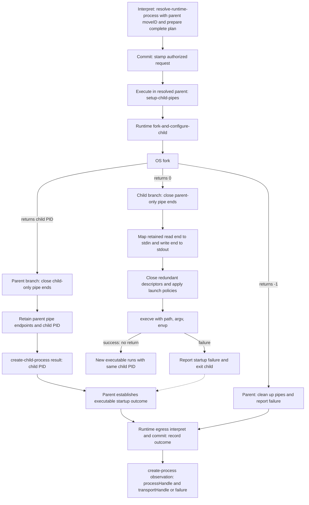

# create-process dependency map

Date: 2026-09-19  
Status: Conceptual dependency map; no implementation changes.

OS means the underlying operating system. Runtime means Skyra's runtime.

## Runtime dependencies

`create-process(executable, transport)` uses a `create-child-process` operation.
The child-creation operation resolves the intended parent's existing MoveID,
prepares two communication pipes in that parent, and calls the runtime wrapper
`fork-and-configure-child`. The wrapper includes both branches after OS `fork()`.

These arrows mean **requires**, not execution order.

`resolve-runtime-process(moveID)` reads canonical runtime state during interpret
and supplies the complete resolved binding to the committed execution request.
Commit and execution do not repeat that lookup. The MoveID identifies an existing
parent association, not the new Move's as-yet-uncreated child.

**The resolved parent must itself execute pipe creation and OS `fork()`.**
Resolving a PID does not allow the runtime to fork a different process. When the
parent is the runtime launcher, the launcher executes these operations directly.
A different parent requires a cooperating execution mechanism, still unresolved.

The executable supplies `path` and arguments; the runtime prepares `argv` and
`envp` before execution. Environment and working-directory policies remain to be
defined. The two pipes cover stdin and stdout; stderr needs an explicit policy
such as inheritance or a separately drained third pipe.

## Execution order

Solid arrows below show execution order; the parent and child branches run in
separate processes and are not ordered relative to each other.

After `fork()`, both processes continue the launcher code. The return value selects
the branch: zero in the child, the child PID in the parent, or minus one on failure.
Each branch closes descriptors in its own table. Closing a descriptor in one
process does not close the other process's copy.

The child performs setup itself before replacing its program with `execve`.
Descriptor mapping requires no second process lookup. Descriptors survive exec
unless marked close-on-exec; the intended stdin and stdout bindings must survive.

## Results and startup boundary

`create-child-process` returns the child PID to its caller in the parent. The
runtime also retains the parent's communication endpoints in private resources;
the PID alone is not a transport. Receiving the PID establishes **fork success**,
not successful executable startup.

The enclosing `create-process` must detect child setup or `execve` failure before
reporting a successful launch. The reporting mechanism remains to be selected
(for example, a launcher-provided startup error channel). Successful `execve`
does not return to the launcher code in the child. A successful executable launch
is also distinct from application readiness.

Creation/setup failures require closing owned endpoints and handling any created
child. Outcomes return through egress interpret/commit to register the process
and transport or record failure. The public `create-process` observation retains
its proposed process handle and transport handle.

See the [create-process contract](create-process.md),
[runtime syscall Surfaces](../skyra-syscall-surface.md), and
[macOS facilities](../mac-syscall-surface.md).
