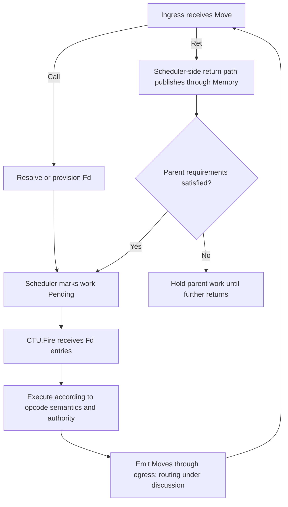

# Skyra: what it is, what it is becoming, and the current architecture

> **Current loop synthesis:** [2026-09-08 — main loop and execution boundaries](2026-09-08-the-main-loop-and-execution-boundaries.md)
> supersedes this summary where ownership, continuation storage, and Move/Ret invocation semantics differ.

**Date:** 2026-09-06  
**Status:** Project synthesis. Distinguishes long-term intent, accepted design, unapproved proposals,
and the behavior currently implemented in `skyra-ctu-engine`. Updated through the
[latest checkpoint](../src/skyra/skyra-ctu-engine/checkpoint.md), including decisions not yet reflected
in the older code surface.

**Skyra is an experimental operating environment for intelligence whose experience can become
reusable, authorized behavior.** It is trying to give people and their agents continuity: a place
where decisions, work, corrections, relationships, and useful ways of acting survive an individual
conversation or model invocation.

At the product level, that is the personal operating system described in the project READMEs:
a persistent world shaped by its human participant. At the execution level, it is becoming a causal
runtime that can take a decision, represent the work it commits to, execute that work within explicit
authority, collect attributable results, and preserve useful behavior for later use.

The connection between those two descriptions is the project. A world that remembers a person's
preferences but cannot reliably act on them has limited continuity. An executor that finishes tasks
but discards the decisions and experience behind them has limited ability to grow with that person.
Skyra is trying to connect memory, action, authority, and adaptation in one system.

The [vision document](../../vision.md) states the execution ambition directly: compile probabilistic
LLM decisions into capability-secure causal programs, run covered behavior without repeated model
involvement, and return to the model when reality exceeds the decisions already represented. That is
a design objective. The current CTU engine is an interface and implementation probe toward it; it
does not yet run the complete local loop.

**The human is the principal around whom the system is organized.** The project's broader language
of beings, worlds, teaching, trust, and relationships describes the intended experience. A person
should be able to teach the system, correct it, delegate work, and observe a lasting change in how
it behaves. The system should accumulate a history that matters to future action.

This makes authority part of the product rather than an administrative detail. A suggested action,
an available mechanism, and permission to use that mechanism are different things. The human's
policy determines what may be delegated. Kernel mechanisms provision and enforce that authority.
Execution consumes the authority it receives; choosing an attractive plan cannot create more of it.
This does not imply asking the person about every operation. The aim is useful autonomous execution
inside already-established bounds, with escalation when the required authority or decision is absent.

The term “operating system” is useful here because the project is assigning responsibilities normally
hidden inside an agent loop: execution, scheduling, memory, loading, access checking, faults, and
lifetime. The present work is a Go runtime hosted on an existing operating system. A replacement
machine OS, a completed personal-agent product, and a general intelligence are not established by
this proposal.

**The central execution idea is that a decision can outlive the inference that made it.** A model
can interpret a novel request and choose work. Once that choice is represented as executable
relationships and return obligations, the runtime should carry the work forward without asking
the model to reconstruct the same plan after every child result.

For example, “compare these two documents” contains work that can be made explicit: obtain the
original, obtain the revision, compare them, and return the comparison. The two retrievals have
separate identities and return destinations. Comparison depends on both observations. If one
retrieval finishes first, the runtime can retain its value and wait for the other. None of that
coordination inherently requires another model decision.

This is the meaning of the compiler/executor split in Skyra's vision. It does not promise that
all work is deterministic, that external services behave predictably, or that a model can never
appear inside a compiled behavior. It means that scheduling and already-decided behavior should
have an explicit runtime representation. Model involvement can be localized to operations that
need it and to conditions that invalidate existing decisions.

The later contract discussions refine the word “compile.” Declaration need not know every return
schema in advance. Cold execution may discover the structure of observations; REMEMBER is intended
to retain those discovered contracts with reusable behavior. Warm execution can then check the
assumptions it previously learned. Exactly how declaration, observed type information, guarded
executable emission, and recompilation fit together remains design work. “The LLM is the compiler”
is a statement about its role, not evidence that this compiler pipeline exists today.

**The current architecture gives each kind of responsibility an owner.** The most important
boundaries in the CTU proposal are these:

| Component or surface | Responsibility | Boundary it preserves |
|---|---|---|
| Human / principal | Goals, policy, delegation, and decisions about additional authority | Desire or model output does not authorize itself. |
| THINK / planning | Interpret needs and propose behavior from available choices | Planning does not mint grants or secretly schedule effects. |
| Kernel | Provision execution, contain Scheduler, own authority and recovery/loading policy | Coordination and provisioning remain distinct from performing an ordinary operation. |
| Scheduler within Kernel | Coordinate lookup/provisioning, mark handed-off work Pending, process emitted Moves, and publish returns through Memory | Pending records outstanding work; it does not certify dependency satisfaction. |
| Memory | Own resident fd entries, live registers, result publication, and eventual reclamation rules | Storage consistency is maintained through Memory operations. |
| CTU — Causal Transition Unit | Execute handed-off entries according to opcode semantics, check access, and emit Moves | Execution does not edit scheduler state; readiness follows the operation rather than a generic admission query. |
| MMU / Touching | Check the target/action access declared by an operation against its authority | Access checking does not perform the operation or create permission. |
| Driver | Perform a concrete synchronous mechanism and return Observation plus Outcome | Filesystem, network, and platform mechanisms do not own scheduling policy. |
| Return ingress/path | Record child observations through Memory, check parent requirements, and hold or release parent work | Scheduler-side publication replaces CTU publication followed by a Landed event. |
| Filesystem driver Resolve | Resolve a MoveID into an Fd containing executable Move and Register | Kernel coordinates installation; the driver does not schedule the returned entry. |
| Runtime.Boot | Wire Kernel and CTU to one shared Memory and install recovery handlers | Boot wiring is not proof of a working execution loop. |

The kernel therefore participates in ordinary scheduling. Older summaries describing a completely
“kernel-free hot path” no longer describe this topology. The current boundary is more precise:
the scheduler belongs to the kernel, while the CTU performs operations and Memory maintains their
resident state. The kernel can provision shared Memory through its methods without becoming the
implementation of every operation.

There is also a broader source-tree boundary described in the [source README](../src/skyra/README.md):
cognition belongs to the agent; topology and live environmental state belong to the world; neutral
space/time/impulse transport connects them; the human-facing agent supplies the user boundary.
That is a useful architectural intention across the project. It should not be read as a claim that
all those layers are already integrated with the new CTU engine.

**The accepted live execution unit now has a concrete home.** The latest review introduces an `Fd`
entry that keeps an executable Move and its live Register together in Memory:

```go
type Fd struct {
    Move     Move
    Register *Register
}

type Memory struct {
    Fds map[MoveID]*Fd
}

func (ct *CTU) Fire(fds []*Fd)
```

**MoveID and EngramID are the same identity in the latest decision.** That ID is carried by the
arriving Move and used for both resident lookup and filesystem resolution. The action plus ordered
observation parameters remains the starting identity rule. Canonical encoding, action namespace,
remembered revisions, repeated identical invocations, and sharing scope remain open. The old code's
separate ID types and optional Move.Engram field await reconciliation; they are not a requirement
for a second backing identity.

Move is the universal wire envelope. It carries the opcode, possibility/chain identity, its own fd,
parent fd, Horizon, and Focus. Registers and live child observations stay in Memory. Kernel provisioning
places the executable Move and Register together in an Fd entry. Scheduler marks selected entries
Pending before handing them to CTU.Fire. Fire itself is the handoff: a batch of references into
Memory.Fds, not the entire table or the scheduler's state map. CTU executes what it receives without
independently resolving each executable during dispatch.

That is a material change from the original overnight surface. The original Memory contained
registers without a home for their executable Moves. The accepted Fd shape addresses that storage
hole. Installation, selection, validity of handed-off references, and event delivery still need
methods and rules; adding a record does not by itself close those interfaces.

The distinction is recorded at the top of the [current surface proposal](../src/skyra/skyra-ctu-engine/surface-proposal.md).
Its later `Execution` wrapper, private execution table, `Compose`, validators, additional events,
and `Runtime.Run` sketches are retained as **unapproved suggestions**. They are not the accepted
architecture merely because they appear in the same document.

**A register represents a return obligation with several child observations.** The current shape
is one Contract plus an ordered list of child entries, each with a child fd and an optional returned
Observation. Nil means the value has not arrived. Position remains stable when completion order varies.

For the document example, the comparison's register declares original B followed by revised C.
If C finishes first, C fills its existing position; it does not become the first argument simply
because it was faster. B later fills its own position. The comparison operation can then use the
correctly associated observations to produce its return.

This gives the system a repeated pattern: children supply observations that contribute to a parent's
observation. The parent itself can be a child in a larger computation. Dependency structure determines
which results enable further work; the root eventually owes an observation to the caller.

Arrival is only one condition. A returned value may be present but fail the expected contract.
Likewise, having valid child inputs does not construct the parent's output. The schema describes
acceptable structure; an operation still has to perform the comparison or other computation.
Current `Ret.Value` carries a proposed output, while return construction and schema-validation
semantics remain unsettled. Full parent dependency/contract checking is intentionally deferred behind
a stub boundary on the return path. “All declared child slots contain observations” was suggested as
a minimal local-probe rule; it is not full validation or an accepted universal contract policy.

`Contract` now holds only Schema. Target, Action, and actual ordered Params stay on invocation.
This supersedes the nominal-register discussion in the September 2 operand summary as a description
of the current live carrier. That earlier discussion remains useful history of the input problem;
it should not be substituted for the accepted ordered-children design.

Two execution addresses route a child's return: ParentFd selects the parent's register, and the
returning move's own Fd selects its child entry within that register. Nil ParentFd identifies the
root. The root still needs an agreed result destination; the existing Land method only routes to
a parent. These details are specified in [register-frame.md](../specs/2026-09-01/register-frame.md).

**Authority, available choices, and committed work are three separate surfaces.** The current
[Focus decision](../specs/2026-09-01/focus-and-move.md) makes this explicit:

| Surface | Question it answers |
|---|---|
| Horizon | Which permissions has the kernel provisioned for this workflow? |
| Focus | Which existing capabilities are presented as choices to this particular move? |
| Dependencies | Which producers or executable relationships has the move committed to using? |

Focus is a slice of existing capabilities selected from Horizon. Showing a choice neither invokes
it nor turns it into a dependency. Choosing Focus does not mint authority, and the current decision
does not make Focus a second permission restriction. Horizon remains the access boundary, including
for grants that were not shown in a particular Focus.

This matters to an LLM-facing system: visibility, selection, and permission are easy to blur in a
prompt. Skyra is giving them distinct structural meanings. Access must still hold when the operation
actually touches a target, including after a wait or recovery. The inherited capability vocabulary
contains target, action, expiry, and signature, but MMU verification is still unimplemented in the
current engine. These are intended security boundaries, not a demonstrated sandbox guarantee.

**The normal loop is Move in, Move out, with opcode-specific behavior.** One ingress receives a
Move and splits on opcode. Its receiver and result signature remain open; its input is decided.
A Call already carries its invocation dependencies and can fire once its executable is resolved and
access is permitted. The return path accumulates observations and holds parent work until its
requirements permit release. There is no generic scheduler-to-CTU readiness query followed by a second
handoff of the same work.

A Move carrying Ret returns an observation for the existing execution. Scheduler-side return
processing writes it through Memory, then checks whether parent work should be released to CTU.
It must not create a second invocation or replace the existing register. This revises the earlier
Ret.Fire-publication-then-Landed design: the scheduler now processes opcodes at ingress and coordinates
the writes. The precise execution/ingress method signatures still need reconciliation.



This is the intended loop, not implemented execution. Parent dependency/contract checking can be
stubbed for the local probe. Other opcodes retain their own semantics. Root output, non-success
handling, and the concrete transport back to ingress remain open.

**Pending replaces Claimed; Issued is removed; Landed is superseded.** Pending means handed-off work
is awaiting a return, not that a separate admission pass certified its dependencies. A Ret Move supplies
the normal result without an additional Landed notification. Involuntary faults still need kernel
coordination, but their representation in the revised Move-return path is unresolved; the older
Faulted type is not proof that the transport has been settled. No ready work alone proves neither
completion nor failure. Root completion, outstanding work, and retirement still need rules.

**Live execution and durable experience have different lifetimes.** Memory holds the resident Move,
its execution-specific register, and arriving values. An engram is intended to preserve an immutable
remembered executable: a body, immediate version-specific child references, and the durable contract
information needed for its return obligations. It does not physically contain every descendant's
entire program.

The current Body direction asks: what observations are required to produce the observation returned
to the parent? Live values satisfy that specification during a particular execution. A value landing
must not rewrite an immutable remembered program. Reusable behavior and today's invocation data
need to remain distinguishable if the same behavior is to run again with different observations.

Versioned references make changes explicit. If remembered child behavior changes, ancestors that
pin that child version may need new versions, while unchanged structure remains shareable. Exact
Engram/Body structs, serialization, digest inputs, and the relationship between stored contracts and
live registers remain open. The earlier content-addressed backing direction must be reconciled with the now-unified
MoveID/EngramID and action/params rule; this is not a completed identity/versioning protocol or codec.

**Filesystem-driver Resolve owns durable lookup and returns the existing Fd entity:**

```go
// Filesystem driver
Resolve(id MoveID) (*Fd, error)
```

Scheduler checks Memory for the incoming ID first. On absence, kernel calls the filesystem driver's
Resolve and installs its returned executable/register entry through Memory. No new result wrapper or
intervening store/pager is needed. The earlier kernel-owned read/decode/verify description is superseded;
Kernel.Load, if retained, coordinates the driver call and installation. Kernel.FS is still typed as the
generic Driver in code and does not yet expose Resolve.

If nothing is remembered for the ID, declaration must supply executable behavior while kernel
provisions the register. **Creating a register alone does not supply behavior.** Absence, I/O failure,
and invalid stored content need distinct treatment; a failed read must not silently trigger declaration.
The absence/error convention and binding of the returned Fd to the incoming Move's parent address and
authority remain open. Stored data must not restore another execution's live return context.

Loading infrastructure must be available independently of the missing executable. The intended storage
is a configurable application-data directory using the filesystem driver, not a disk partition. Sharing
that driver does not give workflows the kernel's authority over durable application data.

Recovery should preserve the incoming identity, inputs, return address, and authority. Resolution
success is neither permission to widen grants nor evidence that the work has executed. The
[loading specification](../specs/2026-09-01/engram-loading-and-fault-return.md) retains older fault
walkthroughs as history; its latest decision banners and the checkpoint take precedence.

**Learning is intended to change future behavior, not only retain previous text.** The repository's
earlier cognitive work explored observation, prediction, correction, retrieval, and how repeated
experience influences subsequent choices. The current execution work tackles a complementary
question: how does a selected behavior become something the system can actually run, check, and
remember?

REMEMBER is the intended bridge between an execution and reusable experience. The contract direction
is to discover structure during execution, record the resulting obligations, and use those learned
assumptions when the behavior runs again. Broader causal-memory work also asks which part of the
execution contributed to an accepted result and deserves durable retention. These ideas belong to
the larger project; their integration with the CTU engine has not been demonstrated.

Useful memory, transient execution evidence, and an exhaustive audit log are different requirements.
A retained causal history may select the work that contributed to an accepted result without retaining
every abandoned attempt. If the product also needs total cost, failure-rate, or full-occurrence claims,
that information needs its own retention rules. Scheduler retirement alone does not decide any of
those policies.

**The explanatory ambition is to retain the conditions that produced an observation.** The
[causal recurrence working formalization](../../causal-recurrence.md) describes provenance with the
same recursive structure as computation: an invocation receives attributable observations, runs
under an artifact and authority context, and returns another observation. The runtime constructs
the record of those relationships rather than asking a worker to invent its own provenance afterward.

That can support a concrete explanation: this behavior, under these permissions, received these
inputs and returned this value. It does not prove that every supplied input influenced a model's
hidden reasoning, that the result is true, or that every omitted event was harmless. Content addressing
protects structural integrity relative to a commitment; stronger claims require trustworthy execution
and appropriate evidence. The current engine's Observation carrier and child entries do not implement
that entire proof system.

The longer-term benefit would be selective repair. When an assumption fails, the system could identify
the affected work and the dependent region that needs reconsideration, then provide that context to
the model. Routine failures with an already-authorized fallback should remain ordinary executable
behavior. A missing file, denied grant, missing engram, malformed output, and genuinely undecided
situation must not all become the same generic “ask the LLM” event.

**Distribution should preserve the meaning of the work across a change of location.** The
[distributed-system summary](distributed-system-summary.md) describes the enduring goal: entity
identity, authority, inputs, returns, and causality remain meaningful when execution crosses a runtime
boundary. An endpoint is a way to reach an entity; it is not the entity's permanent identity. A known
address also does not establish permission to contact it.

**The current discussion is at egress and host/entity routing.** Rather than choosing a new callback
or channel for CTU output, the next step is to examine how the existing Egress boundary routes emitted
Moves, including the local return to scheduler ingress. No output callback/channel has been selected.

The actual engine currently exposes:

```go
Local map[c.Target]Driver
Out   Egress

// Egress interface method
Egress(from c.Target, mv Move) c.Outcome
```

Target contains Entity, Host, and Name. v12's Entity contains ID and a slice of home HostIDs; Address
is volatile and host-resolved. This describes entity → home hosts → address, but inspection found
**no separate host and entity routing maps declared on the current CTU or v12 CTU**. Their shape and
ownership must be discussed, not assumed. Remote execution and return adapters remain unimplemented.
The older distributed summary's Reach/Approach names are not current engine APIs. The enduring
boundary is that location and transport preserve return obligations without granting ambient authority.

Causal evidence, confinement, and artifact identity also remain separate. Knowing which result was
returned does not prove which other resources a remote worker could access. Knowing an artifact hash
does not prove that an honest runtime executed it. A distributed Skyra would need to state which claims
its protocol and deployment can actually establish. The local fd table is a building block toward that
system, not a distributed execution proof or a global coordinator.

**The present implementation is deliberately smaller than this ambition.** Reading the current
engine and its reports yields this status:

| Area | Current status |
|---|---|
| Shared Memory boot wiring | Implemented, with a test that retains preloaded state. |
| Fd containing Move and Register; Memory.Fds; Fire accepting entries | Accepted and reflected in the code's shapes. |
| Ordered child landing | Implemented with copied producer bytes and repeat/conflict checks. |
| Scheduler lifecycle | Legacy Claim/Claimed and basic Landed handling remain as component code/tests. Issued is removed. Pending and Move-return semantics are decided but not reconciled into that surface. |
| Provisioning/selection and return-path release | Still open or stubbed; direct test setup is not a production path. Parent dependency/contract checking is deliberately deferred behind a stub boundary. |
| Shared MoveID/EngramID; filesystem Resolve returning Fd | Decided; separate ID types and the generic filesystem field still need code changes. |
| CTU dispatch, return computation/validation, root delivery | Not implemented as a working loop. |
| Access verification and Driver outcome adaptation | Still unresolved for execution. |
| Loading, recovery, REMEMBER, remote and multicore execution | Deferred or explicitly unimplemented. |
| End-to-end root observation through engine methods | Not demonstrated by this engine. |

The [overnight report](../src/skyra/skyra-ctu-engine/DECISIONS.md) records passing scoped build, vet,
and component tests for that probe. Those results should not be interpreted as a completed runtime.
The report now correctly marks its original missing-descriptor finding as historical: the Fd revision
provides a storage home, while the methods needed to use it remain unsettled.

The next proof is small but consequential: provision a local computation, mark handed-off entries
Pending, execute its children, route Ret Moves through scheduler-side publication, release parent
work through the stubbed requirements boundary, execute it, and deliver its root observation. That would connect the existing pieces
across their ownership boundaries. It would still leave durable compilation, general learning, and
distribution for later work, but it would establish a real execution core on which to build them.

The [checkpoint](../src/skyra/skyra-ctu-engine/checkpoint.md) is the resume point. Start with egress and
host/entity routing, then reconcile the chosen methods before the next handoff. The broader
[review checklist](../src/skyra/skyra-ctu-engine/surface-proposal.md#remaining-issues-before-the-next-handoff)
still tracks installation/selection, root delivery, errors, identity/reuse, authority, and lifetime.
Its older generic-readiness and event-publication proposals are superseded by the opcode-specific loop
above. Full dependency/contract semantics need not be solved to exercise the local loop.

The next implementer should receive a frozen architectural surface and freedom inside method bodies.
The work-order constraints forbid adding structs/fields or reshaping interfaces to conceal gaps;
this review is where those surface changes are decided. Avoid turning the work order into a prescribed
algorithm. The initial probe exposed missing connections and implemented some components; it did not
complete the loop, and the next handoff has not yet been finalized.

**What you are building is a way for delegated intelligence to accumulate operational continuity.**
The personal-world ambition supplies the reason: a person should gain something lasting from teaching,
using, and correcting the system. The causal-runtime architecture supplies the proposed mechanism:
represent decisions as work with explicit inputs, authority, obligations, and outcomes; execute that
work reliably; retain the useful experience; and reconsider the part that no longer fits reality.

The CTU proposal is where that ambition is being tested against executable boundaries. Its significance
is the attempt to make a chosen action, its permissions, its execution, its returned observation, and
its eventual remembrance connect without losing who owns each step. A successful Skyra would let a
person delegate work into a world that becomes more capable through their history with it, while that
history remains inspectable and the person's authority remains the source of what the system may do.
