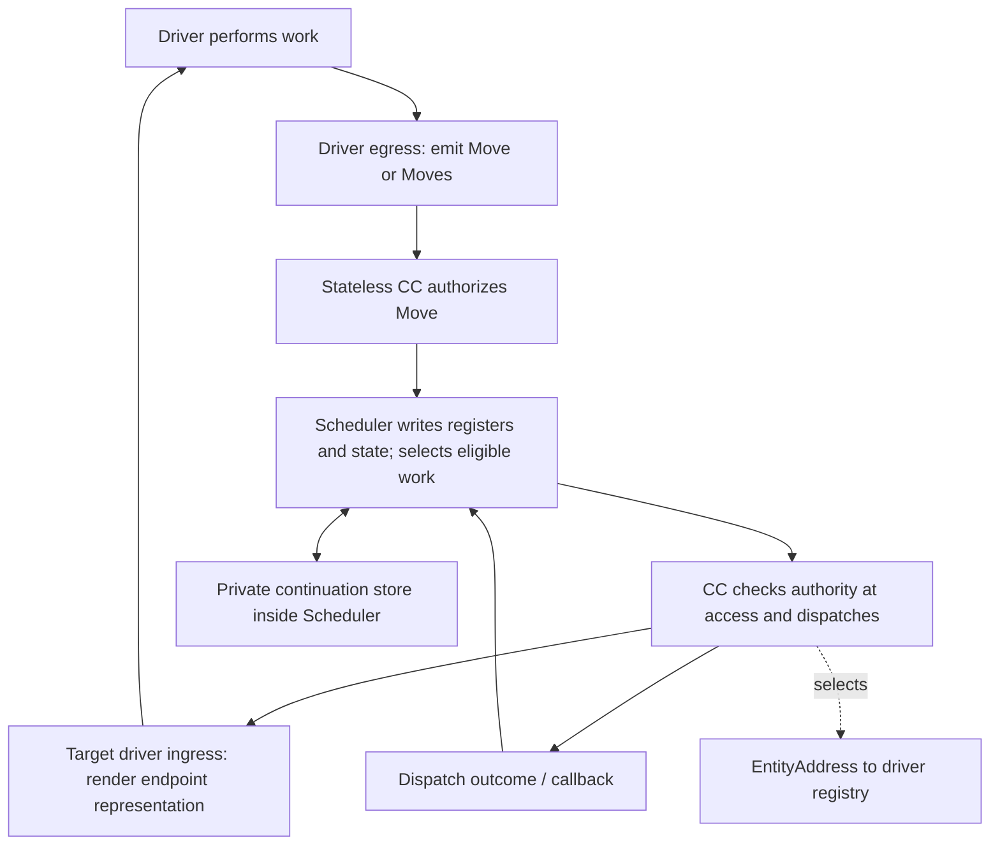

# Skyra: the main loop and execution boundaries

**Date:** 2026-09-08  
**Status:** Coherent synthesis of the latest design. The runtime is not yet implemented against this
surface. This summary supersedes older summaries on ownership, lifecycle, and execution routing.

Skyra's execution model is a loop of addressed invocations. Drivers perform work and emit Moves;
the runtime retains the context needed to continue, determines eligibility, enforces authority, and
routes the next invocation. Human interaction, inference, filesystem operations, remote execution,
and kernel services meet that same boundary.

**Every Move is a new invocation because it invokes something. A Ret invokes the parent's behavior.**
Its connection to earlier work is correlation, not a reason to treat it as something other than an
invocation. The opcode determines what processing that invocation means.

## The loop is the organizing structure



This diagram describes responsibilities, not a prescribed synchronous call stack. Driver results can
arrive later, out of order, or as multiple Moves. One result must not wait for unrelated work in the
same batch merely to be processed.

A driver emits canonical Moves toward the runtime. The stateless Continuation Controller authorizes
them and hands them to Scheduler. Scheduler owns registers, correlation, and continuation state; it is
the single writer and releases eligible work. The CC routes that work to the addressed driver, with authority checked when
the access occurs. The driver interprets the endpoint representation, performs its work, and emits
new Moves. The loop continues.

CC returns a dispatch outcome or invokes a callback describing what happened at handoff. Scheduler
records that outcome through its state-write path. Successful dispatch does not necessarily mean completed
work: the driver may emit its result Move later, through authorization again. Authorized Moves carry
invocations/payloads; dispatch outcomes describe handoff state. Exact methods, callback signatures, and
outcome vocabulary remain open.

## Owners inside the loop

```text
CTU
  ├─ Scheduler
  │    └─ private continuation store / registers
  ├─ Continuation Controller (CC), stateless across invocations
  └─ addressed drivers / registry
       └─ kernel is the root driver
```

| Component | Responsibility |
|---|---|
| Scheduler | Sole writer of registers, correlation, continuation state, and lifecycle; determines eligibility. |
| Continuation Controller | Authorize incoming Moves, enforce access checks, dispatch to drivers, and report handoff outcomes using supplied context. |
| Continuation store | Resident Move/register state, child observations, and outstanding-work correlation, owned by Scheduler. |
| Driver | Translate between canonical Moves and its endpoint representation, perform the work, and emit Moves. |
| Kernel/root driver | Seed authority, grants, loading/persistence services, and recovery behavior reached through its address. |

The CC and Scheduler remain distinct. Scheduler owns the store and its write path. CC retains no
per-invocation continuation state; temporary call context is not a second state store. This replaces
the earlier decision to keep the store privately inside CC. An `Fd{Move, Register}` is the
current starting shape for a resident continuation: work together with the environment needed to resume it.

The CTU coordinates rather than performs application computation. Work that produces values belongs
behind drivers. A concrete pure-computation driver is still to be specified; naming the CC a router must
not conceal a computation implementation inside it.

The kernel no longer contains Scheduler. It is the root driver, registered at boot with seed authority.
Only that root holds authority-minting capabilities; other drivers cannot grant themselves authority.
Human policy remains the source of delegation. CC checking enforces granted authority; it does not mint it.

## Call and Ret are both invocations

Call invokes child behavior. Ret invokes parent behavior with a result related to earlier work. That
parent may consume the observation, wait for further contributions, or cause more work. Ret is not an
extra Landed notification on a separate runtime event channel.

Each emitted Move is a new invocation. Preserve both its own InvocationID and its relationship to the
work it addresses or answers. The engram identity identifies reusable action/params; it does not identify
one occurrence of that action. The exact live correlation key and parent linkage still need a concrete
surface, particularly when identical action/params are invoked more than once.

Pending describes outstanding handed-off work. Issued and Landed are removed from the target model.
Root completion and retirement still need rules; an empty ready selection is not proof of completion.

Readiness follows opcode semantics. Call carries its invocation inputs and can proceed once resolved
and permitted. On the return path, child observations accumulate and parent requirements determine
whether to hold or release continuation work. Full dependency/contract checking remains deliberately
stubbed for the local probe. A proposed all-child-slots-present check is not general schema validation.
The evaluation methods remain to be finalized with Scheduler as the sole owner and writer of
continuation state.

## Drivers normalize the boundary

The receiver owns the format. On the entity side, EntityAddress owns its representation contract and
the driver implements it. On the runtime side, Move is the canonical representation. Consequently,
all driver egress toward the runtime produces Move(s).

An inference driver can normalize model tool calls to Calls and final answers to Rets. A filesystem
driver can normalize its result to Ret. An operation error can be a Ret carrying an error observation.
One driver interaction may emit several Moves; this does not require a special LLM execution path.

The current direction replaces `Local map[Target]Driver` plus a separate Egress mechanism with one
address-to-driver registry. The driver is the runtime's local implementation/proxy for the address;
its entity may be local or remote. A shared EntityAddress can have several host routes without requiring
several incompatible representations. Concrete registry scope, registration, and route selection remain open.

Driver ingress/egress name crossings of that driver boundary. Continuation reads/writes name state operations
owned by Scheduler. They are related but not synonyms. Recording a new invocation is not necessarily writing a
completed child value; the opcode and existing context determine the continuation operation.

Fault handling also uses addressed kernel work rather than a separate handler category. A missing
executable found before driver execution is a resolution concern, not output from a driver that never
ran. The method that turns such a condition into kernel-directed work, its correlation, and failed
recovery handling remain open. No hidden success path or recursive recovery dispatch is implied.

## Addresses, representations, schemas, and authority

The routing structure is:

```text
Entity → EntityAddresses → HostAddresses → Hosts
              │
              └─ stable endpoint representation
```

EntityAddress identifies a stable representation endpoint that may be served from multiple hosts.
Its host routes can change. Host identifies a stable hosting environment, not a network locator;
replacing that environment changes HostID without erasing entity or engram continuity. HostAddress
supplies contact information for that environment.

Entity, address, and host belong on Move. The executable thing belongs on Engram. These are placement
decisions; the existing code does not yet contain the full revised routing surface.

**Every registered EntityAddress needs a schema for the representation it accepts.** This requirement
belongs to the execution endpoint, not automatically to every HostAddress. The existing proposed
`EntityAddress.Representation(history, liveWork)` gives endpoint-specific presentation a home, but its
result and connection to the schema still need definition. Input representation, result representation,
and parent return-contract validation must not be silently conflated.

A schema establishes whether a representation is well-formed. Horizon establishes whether an invocation
may access its target. Knowing an address, choosing a Focus entry, or generating a schema-valid Move
does not grant authority. Every Move, including Ret, is a new invocation with opcode-specific checks.

The CC's proposed method names are `authorize()` and `dispatch()`, still provisional. The binding
access check must hold at dispatch; admission-only checking is insufficient if a capability expires
while work waits. The exact two-stage or combined method arrangement is open. Authority comes from
provisioning and established context, not from a model asserting a Horizon in its output.

Focus remains a selection of available capabilities from the workflow Horizon. It presents choices;
it is neither a list of mandatory dependencies nor another authority-minting mechanism.

## Inference is one implementation of the driver contract

The inference specification chooses Codex as the first planned adapter. Its transport-specific fields
stay inside that driver: opaque tool handles map to Actions, filled arguments become ordered Params,
and external call IDs map to runtime invocation/correlation references. An input schema describes
Params; it is not itself the filled Params used in the identity hash.

Action remains the model-visible instruction. The new adapter direction encodes it in a transport
description while using an opaque tool name; it does not add separate semantic name/title/description
fields to Skyra. The current design proposes a runtime-controlled 160-token default, configurable by
the user. Transport behavior, adapter APIs, and billing/auth availability are not verified or implemented
by this architecture summary.

## Engram: retained work, not the outstanding-work store

```text
EngramID
  └─ InvocationID
       └─ ordered WorkUnits
            ├─ Timestamp
            ├─ WorkArtifact
            ├─ OperatingEntity
            └─ Change
```

The current identity decision is `EngramID = MoveID = fd = hash(Action + ordered Params)`. That is the
entire preimage. Invocation logs and compiled artifacts are associated data attached to that identity;
they do not change it. Canonical byte encoding is still to be specified. Because multiple invocations
share this identity, a live store keyed only by it cannot be assumed to distinguish simultaneous runs.

Each invocation's ordered WorkUnits form its event log; there is no separate Events list. WorkArtifact
represents what the work produced or established—for example, the document content after an edit.
OperatingEntity identifies who handles that work, and Change currently has OpcodeID as its proposed
type. Artifact and change representations remain open.

**Current artifact and history are distinct.** The resulting document persists as current work state
after the edit invocation completes. The invocations, changes, and outcomes that produced it provide
history for the human or LLM changing it. Neither is the in-flight state held in the continuation store.

Executable data can take many forms; the addressed endpoint interprets it. History can inform changes,
while current work is the compilation target. The compiled executor need not interpret its authoring
history, although observations needed by the behavior must remain available as explicit data.

Compilation and Remember are separate:

| Boundary | Meaning |
|---|---|
| Successful compile | Advances the current executable for new invocations. |
| Failed compile | Leaves the previous current executable unchanged. |
| Already-running invocation | Continues with the executable version it started with. |
| Remember | User-initiated commit, decoupled from compile and automatic audit recording. |

`RememberCommit map[InvocationID]*Possibility` is parked on Engram and explicitly OPEN. It does not
settle what a commit captures or how Possibility is represented. Audit accumulation, current compiled
artifact, and committed history must not be collapsed into one automatic transition.

Filesystem-driver `Resolve(id MoveID) (*Fd, error)` remains the selected lookup surface. With the new
Scheduler-owned store and root-driver topology, its installation/result handoff must be reconciled. Absence
of remembered behavior can lead to declaration; a corrupt object or failed read is not the same as
absence. Creating a register does not manufacture executable behavior.

## What is settled and what still needs a surface

The central owners and boundaries are now explicit: drivers execute; stateless CC authorizes and dispatches;
Scheduler owns registers, continuation storage, and eligibility/lifecycle; kernel is the root driver; every driver result is a Move, and every Move is an invocation. CC also reports internal dispatch
outcomes to Scheduler; those reports do not replace driver result Moves.

The next interface pass must specify CC authorization/dispatch methods, Scheduler writes and dispatch
callbacks, schema exposure, registration, live
invocation correlation, continuation installation, and root-result/error handling. It can retain the
stubbed parent-contract boundary. Naming a complete loop does not require prematurely fixing every
transport or compiler mechanism.

The existing engine remains a partial probe: fd/register shapes, boot wiring, ordered landing, and
legacy scheduler component behavior. Its Kernel.Sched, external shared Memory, Event-returning opcodes,
and remaining Claim/Landed surfaces conflict with the latest design. No end-to-end execution or security
guarantee is established by the existing component tests.

A useful next proof is a single trace: inference emits Call; CC authorizes it; Scheduler records it and
selects work; CC dispatches; Scheduler records the handoff outcome. The filesystem driver emits a fresh
Ret invocation; CC authorizes it; Scheduler correlates and records the observation, then releases parent
work when eligible. The proof should expose missing methods while preserving Scheduler as the single
writer and keeping CC stateless across invocations.

## Source and precedence

This synthesis applies the latest decisions—Scheduler owns continuation state, CC is stateless, and
Ret is a new invocation—to [main-loop.md](<../specs/2026-09-07 /main-loop.md>), then incorporates
[drivers and the boundary](<../specs/2026-09-07 /drivers-and-the-boundary.md>),
[inference substrate](<../specs/2026-09-07 /inference-substrate.md>), and the
[entity/address/host and engram thread](<../specs/2026-09-07 /host-entity-address-horizon/README.md>).
Older portions of the dated specs remain historical where they contradict that precedence. This summary
replaces their mixed ownership descriptions without promoting open mechanisms into accepted APIs.
